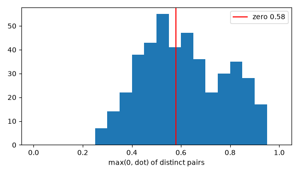
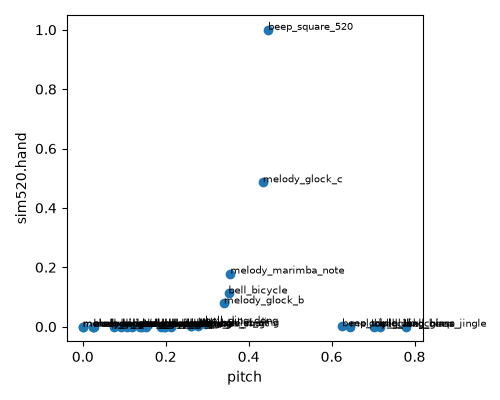

# 파이프라인 보고서

생성 2026-11-20T23:04:32+09:00 · 소리 30개 · 영점 0.58

## 유사도

- 서로 다른 쌍의 max(0, 내적) 중앙값: 0.5989
- 분포: 

### 2단계 후보 수

영점 조정한 유사도가 0.5 이하인 다른 소리의 수. 0이면 그 소리 다음에 대비 단계가 조건을 푼다.

| 소리 | 2단계 후보 |
|---|---|
| beep_cowbell | 28 |
| beep_phone | 16 |
| beep_soft | 28 |
| beep_sonar | 29 |
| beep_square_520 | 29 |
| beep_triple_1k | 29 |
| bell_bicycle | 29 |
| bell_clang | 20 |
| bell_ding | 19 |
| bell_ding_beep | 29 |
| bell_ding_dong | 16 |
| bell_doorbell_ping | 28 |
| bell_glass_jingle | 29 |
| bell_glass_short | 29 |
| bell_jingle | 19 |
| bell_jingle_ring | 26 |
| bell_level_up | 28 |
| bell_mallet_ding | 17 |
| bell_plop | 28 |
| melody_glock_a | 16 |
| melody_glock_b | 18 |
| melody_glock_c | 28 |
| melody_glock_chime | 21 |
| melody_glock_d | 18 |
| melody_instrument | 29 |
| melody_marimba | 23 |
| melody_marimba_note | 16 |
| melody_ringtone_a | 23 |
| melody_ringtone_b | 15 |
| melody_ringtone_c | 17 |

## pitch–sim520.hand (R10)

- 상관 r = 0.21
- 산점도: 

## E2: 520 Hz 닮음 방식별 순위

| 순위 | emb | mel | hand |
|---|---|---|---|
| 1 | square_520 (1.00) | square_520 (1.00) | square_520 (1.00) |
| 2 | beep_520 (0.71) | beep_520 (0.90) | beep_520 (1.00) |
| 3 | sweep_500_3000 (0.66) | white_noise (0.16) | sweep_500_3000 (0.00) |
| 4 | sine_3100 (0.45) | sweep_500_3000 (0.00) | sine_3100 (0.00) |
| 5 | white_noise (0.34) | sine_3100 (0.00) | white_noise (0.00) |

## 소리별 특징

| 소리 | 계열 | pitch | harshness | hand | emb | mel | top3 |
|---|---|---|---|---|---|---|---|
| beep_cowbell | beep | 0.1197 | 0.4602 | 0.0 | 0.2458 | 0.0 | Wood block, Musical instrument, Percussion |
| beep_phone | beep | 0.198 | 0.1971 | 0.0 | 0.2767 | 0.0 | Music, Mallet percussion, Marimba, xylophone |
| beep_soft | beep | 0.1964 | 0.0677 | 0.0 | 0.5052 | 0.0 | Music, Sound effect, Inside, small room |
| beep_sonar | beep | 0.0257 | 0.4283 | 0.0 | 0.3867 | 0.0 | Music, Sonar, Percussion |
| beep_square_520 | beep | 0.4469 | 0.3762 | 0.9998 | 0.6897 | 0.8914 | Music, Noise, Sound effect |
| beep_triple_1k | beep | 0.6254 | 0.3501 | 0.0012 | 0.635 | 0.0 | Beep, bleep, Sound effect, Dial tone |
| bell_bicycle | bell | 0.3514 | 0.1934 | 0.1118 | 0.2491 | 0.0376 | Bell, Bicycle bell, Ding |
| bell_clang | bell | 0.7022 | 0.18 | 0.0 | 0.1754 | 0.108 | Ding, Mallet percussion, Glockenspiel |
| bell_ding | bell | 0.0915 | 0.2277 | 0.0 | 0.2636 | 0.0156 | Music, Glockenspiel, Mallet percussion |
| bell_ding_beep | bell | 0.7163 | 0.375 | 0.0 | 0.4668 | 0.0 | Music, Music for children, Keyboard (musical) |
| bell_ding_dong | bell | 0.295 | 0.2171 | 0.01 | 0.2334 | 0.0186 | Mallet percussion, Music, Marimba, xylophone |
| bell_doorbell_ping | bell | 0.1432 | 0.3661 | 0.0 | 0.2215 | 0.0 | Music, Wood block, Musical instrument |
| bell_glass_jingle | bell | 0.7805 | 1.0 | 0.0 | 0.1677 | 0.1948 | Glass, Jingle, tinkle, Bell |
| bell_glass_short | bell | 0.2606 | 0.2751 | 0.0007 | 0.1837 | 0.0 | Wood block, Music, Glass |
| bell_jingle | bell | 0.1886 | 0.2043 | 0.0 | 0.2413 | 0.0 | Music, Mallet percussion, Marimba, xylophone |
| bell_jingle_ring | bell | 0.2606 | 0.4173 | 0.0009 | 0.3413 | 0.0846 | Music, Ringtone, Telephone |
| bell_level_up | bell | 0.0743 | 0.2333 | 0.0 | 0.3884 | 0.0251 | Ding, Music, Sound effect |
| bell_mallet_ding | bell | 0.2778 | 0.2258 | 0.0034 | 0.234 | 0.1657 | Music, Mallet percussion, Marimba, xylophone |
| bell_plop | bell | 0.2136 | 0.2676 | 0.0 | 0.4991 | 0.0 | Sound effect, Music, Telephone |
| melody_glock_a | melody | 0.1056 | 0.1732 | 0.0 | 0.1994 | 0.0013 | Music, Mallet percussion, Glockenspiel |
| melody_glock_b | melody | 0.3404 | 0.0 | 0.0781 | 0.2693 | 0.0 | Music, Glockenspiel, Mallet percussion |
| melody_glock_c | melody | 0.4344 | 0.0987 | 0.4862 | 0.3821 | 0.0 | Music, Sine wave, Silence |
| melody_glock_chime | melody | 0.6442 | 0.4959 | 0.0003 | 0.2812 | 0.0 | Music, Music for children, Glockenspiel |
| melody_glock_d | melody | 0.0273 | 0.1467 | 0.0 | 0.213 | 0.1315 | Music, Mallet percussion, Glockenspiel |
| melody_instrument | melody | 0.0257 | 0.2726 | 0.0 | 0.3306 | 0.0 | Music, Musical instrument, Drum machine |
| melody_marimba | melody | 0.1525 | 0.1184 | 0.0 | 0.1484 | 0.0 | Mallet percussion, Glockenspiel, Marimba, xylophone |
| melody_marimba_note | melody | 0.3561 | 0.1466 | 0.1788 | 0.1969 | 0.0 | Music, Mallet percussion, Marimba, xylophone |
| melody_ringtone_a | melody | 0.0 | 0.2073 | 0.0 | 0.1976 | 0.0 | Music, Mallet percussion, Percussion |
| melody_ringtone_b | melody | 0.1369 | 0.2751 | 0.0 | 0.1846 | 0.0 | Music, Mallet percussion, Glockenspiel |
| melody_ringtone_c | melody | 0.0 | 0.2416 | 0.0 | 0.2295 | 0.0 | Music, Mallet percussion, Percussion |
