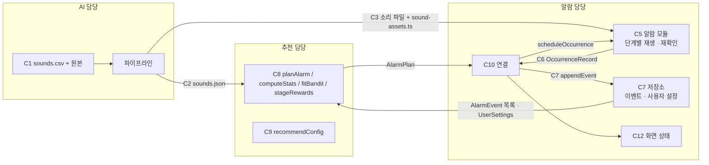

# 계약 (Contracts)

> 3명이 각자 구현해도 이음새가 맞도록, 사람과 사람 사이를 오가는 **모든 데이터·함수·파일·저장 위치**의 모양과 규칙을 정한다.
> **계약이 코드보다 먼저다.** 계약과 다른 코드가 필요하면 코드를 고치기 전에 이 문서를 고치는 PR부터 올린다(9절).
> 설계 배경은 [design.md](design.md)와 [ai-design.md(PR #7)](https://github.com/lyw012012-cpu/appa-anjanda/pull/7), 실험으로 바뀔 값의 근거는 [design.md 6절](design.md#6-구현하면서-하는-실험).

## 0. 경계 지도

| 담당 (제안) | 영역 | 제공하는 계약 | 쓰는 계약 |
|---|---|---|---|
| **A** 앱: 알람·화면 | 예약·단계별 재생·결과 판정, 상태 질문·재확인, 이벤트·사용자 설정 저장, 화면, 연결 | C5 알람 모듈, C6 결과 판정, C7 저장소, C10 연결 순서, C12 화면 상태 | C2, C3, C8, C9 |
| **B** 앱: 추천 | 소리 목록 로드, 습관화, 보상, 사람별 학습(밴딧), 3단계 순서, 시뮬레이션 | C2 로더 검사, C8 추천 모듈, C9 추천 설정 | C4, C7 |
| **C** AI | 소리 수집, 파이프라인(음향 특징·거슬림), 문제 근거 설문 | C1 원본 입력, C2 sounds.json, C3 소리 파일·자산 목록 | — |
| 공통 | — | C4 공유 타입, 1절 공통 규칙 | — |



## 1. 공통 규칙

| 항목 | 규칙 | 예 |
|---|---|---|
| 소리 ID | `^[a-z][a-z0-9_]{0,31}$`. 소문자·숫자·밑줄만. 한 번 쓴 ID는 다른 소리에 다시 쓰지 않는다. **하이픈 금지**(Android 리소스 이름에 쓸 수 없음) | `bell_01` |
| 알람 ID | `a_` + 8자리 소문자·숫자 | `a_k3f9x0qz` |
| 시각 | ISO 8601, **초까지, 기기 현지 오프셋 포함**. 문자열로 저장 | `2026-11-16T07:00:00+09:00` |
| 알람 시각(반복) | `HH:mm` 24시간 | `07:00` |
| 시간 길이 | **초**(정수 또는 소수). 이름 끝에 `Sec`. 설정값만 예외로 이름에 단위를 붙인다(`snoozeMin`) | `playedSec: 12.4` |
| 0~1 점수 | 소수 4자리로 반올림해 저장, 계산 중에는 반올림하지 않는다 | `0.4137` |
| 음량 | 0~1 소수(재생 볼륨 비율) | `0.62` |
| 이벤트 ID | `${alarmId}__${occurrenceAt}` (밑줄 2개) | `a_k3f9x0qz__2026-11-16T07:00:00+09:00` |
| 단계 | `1`(편안함)·`2`(대비)·`3`(낯섦)·`'safety'`(안전장치) | — |
| 이름 | 코드 식별자는 영어 camelCase, 화면 문구·주석은 한국어 | — |
| v1 알람 반복 | **매일 반복**만. 요일 선택은 다음 단계 | — |

## C1. 소리 원본 입력 (수집 → 파이프라인, C 내부)

- 위치: `ai/data/sounds/` 원본 파일, `ai/data/sounds.csv` 목록. 둘 다 **git 제외**(팀 드라이브 공유)
- `sounds.csv` 열 (UTF-8, 머리줄 있음)

| 열 | 형식 | 규칙 |
|---|---|---|
| `id` | 소리 ID | 1절 규칙 |
| `file` | 문자열 | `ai/data/sounds/` 기준 상대 경로. wav·mp3·ogg·flac |
| `title` | 문자열 | 화면에 보일 한국어 이름, 20자 이내 |
| `group` | `bell`·`melody`·`beep`·`nature`·`voice`·`other` | 사람이 듣고 붙인다. 계열마다 3개 이상 |
| `group_rep` | `0`·`1` | 처음 설정 화면에 보여 줄 계열 대표. 계열마다 정확히 1개 |
| `license` | 문자열 | `CC0`, `CC-BY-4.0`, `자체 제작` 등. 빈 칸이면 파이프라인이 거부 |
| `source_url` | 문자열 | 자체 제작이면 `-` |

세 쌍 비교(E1, 시간이 남으면):

| 파일 | 열 | 규칙 |
|---|---|---|
| `ai/data/triplets.csv` (git 제외) | `qid`·`anchor`·`a`·`b` | 소리 ID. 30문항. 같은 계열 안 문항과 다른 계열 문항을 섞는다. 전원이 같은 파일로 답한다 |
| `ai/data/triplet_answers.csv` (git 제외) | `rater`·`qid`·`choice` | `rater`는 `r1`·`r2`·`r3`(이름 대신). `choice`는 `a`·`b` |

## C2. `sounds.json` (파이프라인 → 앱)

- 위치: `app/src/data/sounds.json` (**커밋함**, 파이프라인 출력이며 사람이 손으로 고치지 않는다)
- 만드는 명령: `cd ai && python -m src.build_sounds --csv data/sounds.csv --app ../app`
- 타입은 C4의 `SoundLibrary`. 필드별 규칙:

| 필드 | 규칙 |
|---|---|
| `schemaVersion` | `2`. 아래 규칙이 깨지는 변경이면 올린다(9절) |
| `generatedAt` | 생성 시각(1절 시각 규칙) |
| `model.space` | `"yamnet"`·`"logmel"`·`"hand"`. 기본 `"yamnet"`(E1을 하면 바뀔 수 있음) |
| `model.embeddingDim` | 공간에 따라 `1024`·`64`·손 특징 수 (가짜 데이터는 `4`). 모든 `embedding` 길이와 같아야 함 |
| `model.simMedian` | 서로 다른 소리 쌍 전부의 `max(0, 내적)` 중앙값, 0 이상 1 미만, 소수 5자리. 습관화 일반화와 대비의 바닥값([design.md 4.3](design.md#43-익숙함-노출-기준)). 소리가 1개면 `0` |
| `sounds` | 1개 이상. `id` 중복 없음. `id` 오름차순 정렬 |
| `sounds[].embedding` | 길이 `embeddingDim`, **L2 노름 1 ± 1e-3**, 소수 5자리 |
| `sounds[].sim520.emb·mel·hand` | 각각 0~1. 세 방식 모두 항상 채운다(어느 것을 쓸지는 C9 `sim520Method`). `emb`는 YAMNet 임베딩, `mel`은 평균을 뺀 로그 멜, `hand`는 기본음 400~650 Hz + 홀수 배음 |
| `sounds[].pitch` | 0~1. 기본음(없으면 스펙트럼 중심)의 `log2(Hz)`를 소리 목록 안에서 최소-최대 정규화. 0이 가장 낮음 [가설: 계산식은 C가 정해 PR에 적음] |
| `sounds[].harshness` | 0~1. 날카로움·거칠기 근사치의 정규화 조합. 평균적 경향일 뿐 개인 혐오감이 아님 [가설] |
| `sounds[].groupRep` | `sounds.csv`의 `group_rep` |
| `sounds[].durationSec` | 0보다 큼 |
| `sounds[].top3` | YAMNet 상위 3개 클래스 이름(영어 원문). 설명·검증용, 점수에 안 씀 |
| `sounds[].file` | C3의 파일 이름과 같음 |

**검사 책임:** 파이프라인이 쓰기 전에 위 규칙을 assert(C). 앱 로더 `loadSoundLibrary()`가 읽을 때 같은 규칙을 다시 검사하고, 어기면 어느 규칙을 어긴 어느 `id`인지 적은 `Error`를 던진다(B). 둘이 서로 다른 규칙을 검사하면 안 되므로 규칙은 이 표 하나다.

## C3. 소리 파일과 자산 목록 (파이프라인 → 앱)

| 산출물 | 위치 | 규칙 |
|---|---|---|
| 소리 파일 | `app/assets/sounds/<id>.<ext>` | 파이프라인이 변환해 복사. 기본: mp3, 모노, 44.1 kHz, 30초 이하, 전체 10 MB 이하(I-1 결과로 바뀔 수 있음, 10절). **음량을 맞춘다**: 앞뒤 무음을 자르고(삑-쉼 사이 쉼은 유지) RMS −20 dBFS로 맞추되, 피크가 −1 dBFS를 넘으면 그만큼 낮춘다 [가설]. 깨우는 크기는 앱의 단계별 재생 음량이 정한다. 특징(임베딩·`sim520`·`pitch`·`harshness`)도 맞춘 파형으로 계산한다 |
| 자산 목록 | `app/src/data/sound-assets.ts` | 파이프라인이 생성. `export const soundAssets: Record<SoundId, number> = { bell_01: require('../../assets/sounds/bell_01.mp3'), ... }`. RN은 `require` 경로가 정적이어야 해서 손으로 쓰지 않고 생성한다 |

`sounds.json`의 모든 `id`가 `soundAssets`에 있어야 한다(로더가 검사).

## C4. 공유 타입

- 위치: `app/src/types/contracts.ts`. **이 문서의 코드 블록을 그대로 옮긴다.** 다른 파일에서 같은 모양의 타입을 새로 만들지 않고 여기서 import한다
- 기존 `app/src/stores/alarm-store.ts`의 `Alarm` 타입은 이 파일로 옮긴다

```ts
export type SoundId = string; // 1절 규칙
export type AlarmId = string; // 1절 규칙
export type IsoTime = string; // 1절 규칙
export type SoundGroup = 'bell' | 'melody' | 'beep' | 'nature' | 'voice' | 'other';
export type Sim520Method = 'emb' | 'mel' | 'hand';
export type SimSpace = 'yamnet' | 'logmel' | 'hand';
export type Stage = 1 | 2 | 3;

export interface Sound {
  id: SoundId;
  file: string;
  title: string;
  group: SoundGroup;
  groupRep: boolean;
  license: string;
  sourceUrl: string;
  durationSec: number;
  embedding: number[];
  sim520: Record<Sim520Method, number>;
  pitch: number; // 0 낮음 ~ 1 높음
  harshness: number; // 0~1, 거슬림 추정
  top3: string[];
}

export interface SoundLibrary {
  schemaVersion: 2;
  generatedAt: IsoTime;
  model: { space: SimSpace; embeddingDim: number; simMedian: number };
  sounds: Sound[];
}

export interface Alarm {
  id: AlarmId;
  time: string; // 'HH:mm', 매일 반복
  enabled: boolean;
}

/** 처음 설정과 "이 소리 빼기". C7 저장소에 둔다 */
export interface UserSettings {
  chosen: SoundId[]; // 처음 설정에서 고른 소리(0개 가능)
  excluded: SoundId[]; // "이 소리 빼기"
  startVolume: number; // 0~1, "이 크기면 깰 것 같나요?"로 정함
  gentleMode: boolean; // 대비 폭 축소, 재확인은 진동만 (MVP 밖이면 항상 false)
}

/** 밴딧 입력. [상수 1, 단계 위치 (stage−1)/2, pHabit, sim520n, pitch] 순서 고정 */
export type Features = [number, number, number, number, number];

/** 한 단계의 계획 */
export interface StagePlan {
  stage: Stage;
  soundId: SoundId;
  volume: number; // 0~1
  features: Features; // 고를 때의 x(c, stage)
  predicted: number; // θ̃ · x, 이유 화면·분석용
}

export type PlanFallback = 'recent' | 'contrast' | 'habituated';

/** 알람 한 번의 계획 = 3단계 순서 + 이유 */
export interface AlarmPlan {
  stages: [StagePlan, StagePlan, StagePlan];
  weights: [number, number, number, number, number]; // 1·2단계에 쓴 θ̃ (3단계는 평균 μ로 고름)
  reason: string; // 이유 한 줄(C8 규칙 11)
  fallback: PlanFallback[]; // 조건을 푼 순서대로. 없으면 []
  seed: string;
  configVersion: number;
}

/** 실제로 재생된 구간 하나. 스누즈 뒤 같은 단계가 다시 나올 수 있다 */
export interface PlayedStage {
  stage: Stage | 'safety';
  soundId: SoundId | null; // safety는 라이브러리 기본음이라 null
  volume: number;
  startedAt: IsoTime;
  playedSec: number; // 이 구간에서 실제로 울린 시간
  end: 'next' | 'dismissed' | 'snoozed' | 'gave_up'; // next: 단계 시간이 끝나 다음으로, gave_up: 안전장치까지 끝남
  features: Features | null; // StagePlan에서 복사. safety는 null
}

export type StateAnswer = 'sleepy' | 'waking' | 'awake' | null; // 😴 🚶 ☀️, 무응답 null
export type RecheckResult = 'none' | 'pending' | 'responded' | 'no_response';

/** 알람 한 번(occurrence)의 기록. C5가 만들고 C10이 상태 질문·재확인을 채운다 */
export interface OccurrenceRecord {
  alarmId: AlarmId;
  occurrenceAt: IsoTime; // 예약된 시각(스누즈로 다시 울려도 처음 값 유지)
  endedAt: IsoTime;
  played: PlayedStage[]; // 재생 순서대로
  snoozeCount: number;
  dismissed: boolean; // 끝까지 못 끄면 false
  backfilled: boolean; // 앱이 꺼져 있어 나중에 소급 판정했나
}

export interface AlarmEvent extends OccurrenceRecord {
  schemaVersion: 2;
  eventId: string; // 1절 규칙
  plan: AlarmPlan | null; // 계획 없이 울린 경우 null
  state: StateAnswer;
  recheck: RecheckResult;
  appVersion: string; // app.json version
}

export interface SoundStat {
  soundId: SoundId;
  plays: number; // 이 소리가 재생된 구간 수
  habitStrength: number; // H, design.md 4.2
  pHabit: number; // 1 − exp(−H)
  habituated: boolean; // pHabit ≥ habituatedAt
  lastPlayedAt: IsoTime | null;
}

/** 사람별 학습 결과. 저장하지 않고 매번 기록에서 계산 */
export interface BanditModel {
  mean: [number, number, number, number, number]; // μ
  cov: number[][]; // Σ, 5×5
  n: number; // 학습에 쓴 구간 수
}
```

## C5. 알람 모듈 (A 제공, C10이 사용)

- 위치: `app/src/lib/alarm.ts`. 내부 구현(알람 라이브러리 + 앱 화면의 expo-audio 재생인지, 포그라운드 경로인지)은 I-1 결과로 바뀌어도 **아래 함수 모양은 바꾸지 않는다**([design.md AD4](design.md#3-아키텍처-결정))

```ts
/** 다음 울릴 시각. 순수 함수. now가 정확히 그 시각이면 내일 */
export function nextOccurrence(time: string, now: IsoTime): IsoTime;

/** 이 알람의 기존 예약을 지우고 at에 plan으로 새로 예약 */
export function scheduleOccurrence(alarm: Alarm, plan: AlarmPlan, at: IsoTime): Promise<void>;

export function cancelAlarm(alarmId: AlarmId): Promise<void>;

/** 알람 한 번이 끝날 때마다 한 번 호출(끔 / 끝까지 못 끔). 반환값은 구독 해제 함수 */
export function onOutcome(listener: (r: OccurrenceRecord) => void): () => void;

/** 끈 뒤 afterMin분 뒤 재확인. soft면 부드러운 소리, gentleMode면 진동만 */
export function scheduleRecheck(eventId: string, afterMin: number, soft: boolean): Promise<void>;

/** 재확인 결과. 응답 없음이면 그 시점에 다시 알람을 울린 뒤 호출 */
export function onRecheck(listener: (eventId: string, result: 'responded' | 'no_response') => void): () => void;

/** 앱 시작 시 호출. 앱이 꺼져 있는 사이 끝난 알람을 소급 판정 */
export function reconcile(now: IsoTime): Promise<OccurrenceRecord[]>;

export class AlarmError extends Error {
  code: 'permission_denied' | 'sound_missing' | 'schedule_failed';
}
```

- **재생 순서**: 1단계 → `stageSec` 동안 못 끄면 2단계 → 3단계 → 안전장치(라이브러리 기본 알람음, 최대 음량). 단계마다 `plan.stages[i].soundId`·`volume`으로 재생하고 `PlayedStage`를 남긴다
- **스누즈**: 지금 재생을 멈추고 `snoozeMin` 뒤 **2단계부터** 다시. `snoozeCount`가 `maxSnooze`를 넘으면 다음 울림은 3단계부터
- `scheduleOccurrence` 실패는 `AlarmError`로 던진다. `soundAssets`에 없는 `soundId`면 `sound_missing`
- 같은 occurrence에 대해 `onOutcome`은 **정확히 한 번**. `reconcile`이 돌려준 것과 `onOutcome`으로 보낸 것이 겹치면 안 된다
- **I-1에서 단계별 소리 바꾸기가 안 되면**([ai-design.md](https://github.com/lyw012012-cpu/appa-anjanda/pull/7) 8절 대안): `plan.stages[0]`만 울리고(끌 때까지 반복), 2·3단계는 재생하지 않는다. 기록 모양은 같다(`played`에 1단계만). 이 경우 C8은 그대로 두고 화면에 "단계 재생 꺼짐"을 표시한다

## C6. 결과 판정 규칙 (A가 C5 안에서 적용)

| 상황 | `PlayedStage.end` | 그 뒤 |
|---|---|---|
| 이 단계의 `stageSec`이 끝날 때까지 끄지 않음 | `next` | 다음 단계 재생(3단계 뒤는 안전장치) |
| 이 단계에서 끄기 | `dismissed` | 알람 끝, `dismissed: true` |
| 이 단계에서 스누즈 | `snoozed` | `snoozeMin` 뒤 2단계부터(C5) |
| 안전장치가 `maxSec` 동안 울렸는데 못 끔 | `gave_up` | 알람 끝, `dismissed: false` |
| 앱이 꺼져 있어 위를 그때 못 봄 → 다음 실행의 `reconcile` | 알 수 있는 데까지 | `backfilled: true` |

- `playedSec`은 그 구간에서 실제로 울린 시간(스누즈·끄기로 끊기면 그때까지)
- 알람이 울리기 전에 끄거나(enabled false) 지우거나 시각을 바꾸면 그 occurrence는 **이벤트를 만들지 않는다**
- 보상과 노출은 B가 C8에서 계산한다. A는 `played`를 정확히 채운다

## C7. 저장소 (A 제공, B·C10이 사용)

- 위치: `app/src/stores/event-store.ts`, `app/src/stores/settings-store.ts` (Zustand + persist). 기기에만 저장([design.md AD6](design.md#3-아키텍처-결정))

```ts
/** 같은 eventId면 덮어쓴다(멱등). 상태 질문·재확인 결과를 나중에 붙일 때도 이걸로 */
export function appendEvent(e: AlarmEvent): void;

/** occurrenceAt 오름차순. 반환 배열을 고치지 않는다 */
export function getEvents(): readonly AlarmEvent[];

/** 시연용 초기화(개발 메뉴) */
export function clearEvents(): void;

export function getSettings(): UserSettings;
export function updateSettings(patch: Partial<UserSettings>): void;
```

- 로컬 저장소 키: `appa.events.v2`, `appa.settings.v1`. 설정 기본값: `{ chosen: [], excluded: [], startVolume: 0.5, gentleMode: false }`
- 로컬 저장 기술: Zustand `persist` + `@react-native-async-storage/async-storage` [권장]. A가 뼈대 단계에서 `npx expo install`로 추가

## C8. 추천 모듈 (B 제공, C10·화면이 사용)

- 위치: `app/src/lib/recommend.ts`, `app/src/lib/sound-library.ts`. **모두 순수 함수**(시간·저장소·네트워크에 접근하지 않음)

```ts
/** sounds.json + soundAssets를 읽고 C2·C3 규칙 검사. 어기면 Error */
export function loadSoundLibrary(): SoundLibrary;

/** 소리별 습관화. 이벤트가 없는 소리도 plays 0으로 포함 */
export function computeStats(
  library: SoundLibrary,
  events: readonly AlarmEvent[],
  config: RecommendConfig,
  now: IsoTime, // 순수 함수라 시계를 직접 읽지 않고 받는다
): Record<SoundId, SoundStat>;

/** 재생된 구간마다 보상. safety 구간과 features가 null인 구간은 빠진다 */
export function stageRewards(e: AlarmEvent, config: RecommendConfig): { features: Features; reward: number }[];

/** 사람별 학습. occurrenceAt ≤ now인 이벤트의 stageRewards로 사후값 계산 */
export function fitBandit(events: readonly AlarmEvent[], config: RecommendConfig, now: IsoTime): BanditModel;

/** 알람 한 번의 3단계 계획 */
export function planAlarm(input: {
  library: SoundLibrary;
  events: readonly AlarmEvent[];
  settings: UserSettings;
  config: RecommendConfig;
  now: IsoTime;
  seed: string; // Thompson 표본·음량 흔들림용. C10은 `${alarmId}__${다음 occurrenceAt}`을 넘긴다
}): AlarmPlan;
```

**동작 규칙** (수식은 [design.md 4절](design.md#4-상세-설계))

1. 거리: `sim(a, a)` = 1. `a ≠ b`면 `simNormalize`가 `'median'`일 때 `clip((max(0, 내적) − m) / (1 − m), 0, 1)`, `m` = `library.model.simMedian`. `'none'`이면 `max(0, 내적)`
2. 습관화(**노출 기준**): `H(c) = Σ_구간 p exposureGain × (p.playedSec / stageSec) × sim(c, p.soundId) × exp(−Δ일 / tauDays)`. `p`는 모든 이벤트의 `played` 중 `soundId`가 있는 구간, `Δ일` = (`now` − `p.startedAt`)을 일 단위 소수로. `now`보다 뒤는 무시. 결과의 좋고 나쁨은 쓰지 않는다. `pHabit` = 1 − exp(−H), `habituated` = `pHabit ≥ habituatedAt`
3. 특징: `x(c, s) = [1, (s − 1)/2, pHabit(c), sim520n(c), c.pitch]`. `sim520n`은 `sim520Method` 값을 소리 목록 전체 기준 최소-최대 정규화(최댓값 = 최솟값이면 모두 0.5)
4. 보상(재생된 구간마다, [ai-design.md](https://github.com/lyw012012-cpu/appa-anjanda/pull/7) 7.6):
   - `end`가 `next`: 0. 단, 그다음 구간에서 시작 후 `graceSec` 안에 `dismissed`면 **이 구간**을 끈 것으로 보고 `0.5 + 0.5 × exp(−playedSec / reward.tauSec)`를 주고, 그다음 구간은 학습에서 뺀다
   - `dismissed`: `0.5 + 0.5 × exp(−playedSec / reward.tauSec)`
   - `snoozed`: `reward.snoozed`
   - `dismissed: false`(끝까지 못 끔)인 이벤트: 모든 구간 0
   - `recheck`가 `'no_response'`(다시 잠듦): 끈 구간의 보상을 `reward.fellAsleep`으로 바꾼다
   - 상태 질문(`state`)은 보상에 쓰지 않는다
5. 사후값: `A = I / priorVar + Σ x xᵀ / noiseVar`, `cov = A⁻¹`, `mean = cov × (priorMean / priorVar + Σ x × reward / noiseVar)`. `x`는 구간의 `features`(그때 값)
6. 가중치 표본: `banditMode`가 `'mean'`이면 `θ̃ = mean`. `'thompson'`이면 `θ̃ = mean + L z`, `L`은 `cov`의 촐레스키 분해, `z`는 표준정규 5개. 난수는 `seed`의 FNV-1a 32비트 해시를 씨앗으로 한 mulberry32, 정규분포는 Box-Muller. **`Math.random` 금지**(M2). 같은 난수열에서 `z`를 먼저 뽑고 음량 흔들림을 뒤에 뽑는다
7. 후보 공통: 소리 목록 − `settings.excluded`. 거슬림 상한(`harshCap`)과 `excluded`는 **어떤 경우에도 풀지 않는다**
8. 1단계(편안함): 공통 후보 − 최근 `recentExclude`개 중 `harshness ≤ comfortCap`(부드러운 모드면 `comfortCap` 그대로)이고, `settings.chosen`이 있으면 `chosen`에 들거나 `max sim(c, chosen) ≥ prefMinSim`. `chosen`이 비면 이 조건 없음. `θ̃ · x(c, 1)`이 가장 큰 것
9. 2단계(대비): 공통 후보 − 최근 제외 − 1단계 소리 중 `harshness ≤ harshCap`이고 `sim(c, 1단계) ≤ contrastMaxSim`(부드러운 모드면 `contrastMaxSimGentle`). `θ̃ · x(c, 2)`가 가장 큰 것
10. 3단계(낯섦): 공통 후보 − 1·2단계 소리 중 `harshness ≤ harshCap`, `pHabit < habituatedAt`, 1·2단계와 각각 `sim ≤ contrastMaxSim`. **`mean · x(c, 3)`(표본 아님)** 이 가장 큰 것. 최근 제외는 적용하지 않는다
11. 후보가 비면 `recent` → `contrast` → `habituated` 순서로 조건을 하나씩 풀고 푼 것을 `fallback`에 순서대로 기록. 다 풀어도 비면 1단계 소리를 다시 쓴다
12. 음량: `vol(s) = min(maxVolume, startVolume × (1 + volumeStep)^(s − 1)) × (1 + volumeJitter × u)`, `u`는 −1~1 균등(같은 난수열), 결과를 0~`maxVolume`으로 자른다
13. 이유 한 줄: 이 사람의 `mean`에서 사전값과 가장 많이 달라진 특징(상수·단계 제외)을 골라 문장으로("저음에 잘 깨셨어요", "낯선 소리에 잘 깨셨어요", "520 Hz를 닮은 소리에 잘 깨셨어요"). 학습한 구간이 `reasonMinN`개 미만이면 "아직 배우는 중이에요: 처음 고른 소리와 520 Hz 닮음으로 골랐어요"
14. 점수가 같으면 `soundId` 오름차순으로 앞선 것
15. **결정적**: 같은 입력(`now`·`seed` 포함)이면 항상 같은 출력
16. 성능: 소리 50개 × 1024차원, 이벤트 500개에서 200 ms 이내(Q2)

## C9. 설정 (실험으로 바뀌는 값)

- 위치: `app/src/config.ts`. 값을 바꾸는 PR에는 근거 실험 결과 한 단락을 붙이고 `configVersion`을 1 올린다

```ts
export const alarmConfig = {
  stageSec: 30, // [가설]
  maxSec: 300, // 안전장치가 이 시간 동안 울리면 gave_up
  snoozeMin: 5,
  maxSnooze: 2,
  recheckSleepyMin: 3, // 😴
  recheckWakingMin: 7, // 🚶·무응답
} as const;

export interface RecommendConfig {
  configVersion: number;
  tauDays: number;
  exposureGain: number;
  habituatedAt: number;
  recentExclude: number;
  sim520Method: Sim520Method;
  simNormalize: 'none' | 'median';
  comfortCap: number;
  harshCap: number;
  prefMinSim: number;
  contrastMaxSim: number;
  contrastMaxSimGentle: number;
  volumeStep: number;
  volumeJitter: number;
  maxVolume: number;
  reward: { tauSec: number; graceSec: number; snoozed: number; fellAsleep: number };
  bandit: {
    mode: 'thompson' | 'mean';
    priorMean: [number, number, number, number, number]; // [상수, 단계, pHabit, 520 닮음, 음높이]
    priorVar: number;
    noiseVar: number;
  };
  reasonMinN: number;
}

export const recommendConfig: RecommendConfig = {
  configVersion: 2,
  tauDays: 3,
  exposureGain: 0.5,
  habituatedAt: 0.5,
  recentExclude: 3,
  sim520Method: 'hand', // E2
  simNormalize: 'median',
  comfortCap: 0.3,
  harshCap: 0.9,
  prefMinSim: 0.5,
  contrastMaxSim: 0.5,
  contrastMaxSimGentle: 0.7,
  volumeStep: 0.25,
  volumeJitter: 0.1,
  maxVolume: 0.9,
  reward: { tauSec: 10, graceSec: 5, snoozed: 0.3, fellAsleep: 0.2 },
  bandit: { mode: 'thompson', priorMean: [0.2, 0.3, -0.5, 0.5, 0], priorVar: 0.05, noiseVar: 0.04 },
  reasonMinN: 10,
};
```

모든 값은 [가설]이고 E5(I-13 시뮬레이션)에서 조정한다. 허용 범위:

| 값 | 허용 범위 |
|---|---|
| `stageSec` | 10~120 |
| `tauDays` | 0 초과, 30 이하 |
| `exposureGain` | 0 초과, 2 이하 |
| `habituatedAt`·`comfortCap`·`harshCap`·`prefMinSim`·`contrastMaxSim*`·`maxVolume` | 0~1 |
| `volumeStep` | 0~1, `volumeJitter` 0~0.3 |
| `reward.tauSec`·`graceSec` | 0 초과 |
| `reward.snoozed`·`fellAsleep` | 0 이상 0.5 미만 |
| `bandit.priorMean` | 각각 −1~1. 기본값은 "익숙할수록 나쁨, 520 닮을수록 좋음, 뒤 단계일수록 잘 깸, 음높이는 모름" |
| `bandit.priorVar`·`noiseVar` | 0 초과 |

`bandit.mode`는 앱에서 `'thompson'`, 계약 테스트(8절)와 시연 고정에서 `'mean'`을 쓴다. 거리 공간(`model.space`)은 설정이 아니라 `sounds.json`에 들어간다(C2).

## C10. 연결 순서 (A 제공)

- 위치: `app/src/lib/orchestrator.ts`. 화면과 앱 시작 코드는 이 함수들만 부른다

```ts
/** 알람 한 번 끝: 저장 → 다음 계획 → 재예약. 끈 경우 화면이 상태 질문을 띄운다 */
export function handleOutcome(r: OccurrenceRecord): Promise<void>;

/** 끈 뒤 "지금 어떠세요?" 답 → 이벤트에 state 붙임 → 재확인 예약 */
export function recordState(eventId: string, answer: StateAnswer): Promise<void>;

/** 재확인 결과 → 이벤트에 recheck 붙임(appendEvent 덮어쓰기). 다음 계획은 다시 하지 않는다 */
export function handleRecheck(eventId: string, result: 'responded' | 'no_response'): void;

/** 알람 추가·켜기·시각 변경·설정 변경 시: 계획 → 예약 */
export function armAlarm(alarm: Alarm): Promise<void>;

/** 앱 시작 시: reconcile → handleOutcome 반복 */
export function onAppStart(): Promise<void>;
```

`handleOutcome` 순서와 실패 시 동작:

| 단계 | 할 일 | 실패하면 |
|---|---|---|
| 1 | 그 알람의 대기 중 계획(`pending[alarmId]`)을 꺼내 `plan`으로. 각 `PlayedStage.features`를 계획의 같은 단계에서 복사 | 없으면 `plan: null`, `features: null` |
| 2 | `AlarmEvent` 조립(`state: null`, `recheck: 'none'`) 후 `appendEvent` | — (동기, 실패 없음) |
| 3 | `next = nextOccurrence(alarm.time, now)`, `planAlarm({ ..., settings: getSettings(), seed: \`${alarm.id}__${next}\` })` | 직전 계획 유지, 오류 기록 |
| 4 | `scheduleOccurrence(alarm, plan, next)` | 화면에 오류 띠. 알람은 `enabled` 유지 |
| 5 | `pending[alarmId] = plan` | — |

`recordState` 규칙: 😴 → `scheduleRecheck(eventId, recheckSleepyMin, soft: true)`, 🚶·무응답(`null`) → `recheckWakingMin`, ☀️ → 재확인 없음(`recheck: 'none'` 유지). 재확인을 예약하면 `recheck: 'pending'`. 상태 질문을 일정 시간(60초 [가설]) 안에 안 누르면 `null`로 처리한다.

- 대기 중 계획 저장소 키: `appa.pending.v2`. 알람 저장소 키: `appa.alarms.v1`
- 꺼진 알람(`enabled: false`)은 3~5를 하지 않는다

## C11. Firestore (다음 단계, PoC에서 쓰지 않음)

PoC는 기록을 기기에만 둔다([design.md AD6](design.md#3-아키텍처-결정)). 다음 단계에서 보관이 필요하면 이 절을 다시 연다. 그때의 원칙만 남긴다.

- 경로 `users/{uid}/events/{eventId}`, 익명 인증, 자기 `uid` 경로만 읽고 쓰는 보안 규칙
- 앱은 Firestore를 읽지 않는다(추천은 로컬 이벤트로, M3 ESLint 규칙 유지)
- `app/src/lib/firebase.ts`는 남겨 두되 PoC 코드에서 import하지 않는다

## C12. 화면이 읽는 상태 (A 화면 ↔ B 추천)

| 화면에 보일 것 | 어디서 |
|---|---|
| 처음 설정: 계열 대표 소리 고르기(서로 다른 계열 2개 이상 권장), 시작 음량 | `groupRep`인 소리, `updateSettings` |
| 알람 목록·시각·켜짐 | `useAlarmStore` → `Alarm` |
| 다음 알람의 소리 3개와 음량 | `pending[alarmId].stages` → `title`·`volume` |
| 이유 한 줄 | `pending[alarmId].reason`(C8 규칙 13) |
| 알람 화면: 지금 단계, 끄기·스누즈·**이 소리 빼기** | C5 재생 상태, `updateSettings({ excluded })` |
| 끈 직후 "지금 어떠세요?" 😴 🚶 ☀️ | `recordState`. 끝까지 못 끈 알람에는 묻지 않는다 |
| 통계 화면(시연용): 소리별 `pHabit`, 이 사람의 경향(특징별 `mean`·학습량 `n`), 안전장치까지 간 비율 | `computeStats`, `fitBandit`, 이벤트 |
| 오류 띠 | `AlarmError.code`별 한국어 문구(A가 정함) |

## 8. 가짜 데이터 (먼저 시작하는 사람용)

- `app/src/data/sounds.fixture.json`: 아래 4개(`embeddingDim: 4`). C 파이프라인이 끝나기 전 B·A가 쓴다
- 이 데이터에 대한 **기대 결과가 곧 C8 계약 테스트**다

| id | group | embedding | sim520.hand | pitch | harshness |
|---|---|---|---|---|---|
| `beep_3k` | beep | [0.6, 0.8, 0, 0] | 0.6 | 1.0 | 0.8 |
| `melody_a` | melody | [0, 0, 1, 0] | 0.0 | 0.4 | 0.1 |
| `nature_a` | nature | [0, 0, 0.6, 0.8] | 0.2 | 0.6 | 0.1 |
| `square_520` | beep | [1, 0, 0, 0] | 1.0 | 0.0 | 0.5 |

(`emb`·`mel`은 `hand`와 같은 값, `top3`는 `[]`, `durationSec` 3, `license` `"자체 제작"`, `groupRep`는 `melody_a`·`nature_a`·`square_520`이 참. `model.simMedian` = 0: 서로 다른 쌍 6개의 내적이 0, 0, 0.6, 0.6, 0, 0)

설정: `recommendConfig` 기본값에서 `recentExclude: 1`, `bandit.mode: 'mean'`만 바꿈. 사용자 설정: `chosen: ['melody_a']`, `excluded: []`. `now` = `2026-11-16T07:00:00+09:00`. 아래 값은 파이썬으로 계산했고, 테스트는 소수 4자리로 반올림해 비교한다.

**가. 습관화** — 모두 `features: null`(학습에 안 씀)

| 이벤트 | `computeStats` 기대 결과 | 확인하는 규칙 |
|---|---|---|
| A: `square_520`이 11-14·11-15 07:00에 구간마다 60초씩 재생(노출 2) | `square_520` 0.7077, `beep_3k` 0.5219(한 번도 안 울렸는데 `habituated: true`), `melody_a`·`nature_a` 0 | 노출, **일반화** |
| A, `now` = `2026-11-30T07:00:00+09:00` | `square_520` 0.0115, `habituated: false` | **회복** |
| B: A와 같은 시각, 구간마다 30초(노출 1) | `square_520` 0.4593(`habituated: false`), `beep_3k` 0.3086 | 두 번으로는 익숙해짐이 아님 |
| C: `square_520`이 11-13·14·15에 30초씩 | `square_520` 0.5502(`habituated: true`), `beep_3k` 0.3808 | **반복 노출**로 익숙해짐 |

**나. 3단계 고르기** (사전값 `[0.2, 0.3, −0.5, 0.5, 0]`)

| 경우 | 기대 결과 | 확인하는 규칙 |
|---|---|---|
| 이벤트 A | 1단계 `nature_a`(0.3), 2단계 `beep_3k`(0.389), 3단계 `melody_a`(0.5), `fallback: ['contrast']` | 1단계: 최근 제외 + 거슬림 상한 + 선호(`melody_a`와 0.6) / 2단계: 1단계와 다름 / 3단계: 남은 후보가 1단계와 비슷해 대비를 풂 |
| 이벤트 없음, `recentExclude: 0` | 1단계 `nature_a`(0.3), 2단계 `square_520`(0.85), 3단계 `beep_3k`(0.8), `fallback: ['contrast']` | 첫 실행 |
| 이벤트 A, `excluded: ['nature_a']` | 1단계 `melody_a` | "이 소리 빼기" |
| 이벤트 A, `harshCap: 0.4` | 어떤 단계에도 `beep_3k`(0.8)·`square_520`(0.5)이 나오지 않는다 | 거슬림 상한은 풀지 않음 |

**다. 보상과 사람별 학습** — 이벤트 D: 알람 3번, 모두 `now` 이전. 특징은 `pHabit` 0일 때 값 `[1, 단계, pHabit, 520, 음높이]`.

| 이벤트 | 재생된 구간 | 보상 |
|---|---|---|
| D1 | 1단계 `melody_a` `[1, 0, 0, 0, 0.4]`, 5초에 `dismissed` | 0.8033 |
| D2 | 1단계 `beep_3k` `[1, 0, 0, 0.6, 1.0]` 30초 `next` → 2단계 `square_520` `[1, 0.5, 0, 1, 0]` 8초에 `dismissed` | 0, 0.7247 |
| D3 | D2와 같음 | 0, 0.7247 |

(2단계를 8초에 끈 것은 `graceSec` 5초보다 늦어 2단계의 공이다)

| 경우 | 기대 결과 | 확인하는 규칙 |
|---|---|---|
| `fitBandit(이벤트 D)` | `mean` = `[0.3639, 0.3104, −0.5000, 0.1972, −0.2664]`, `n` 5 | 보상, 사후값. 고음 소리로 못 일어난 사람 → 음높이 가중치가 음수(유형 ⑥) |
| 이벤트 없음, `priorMean`을 위 `mean`으로, `recentExclude: 0` | 1단계 `melody_a`(0.2573) — 사전값이면 `nature_a` | 학습이 고르는 소리를 바꾼다 |
| 1단계 30초 `next` → 2단계 시작 3초 뒤 `dismissed` | 1단계 보상 `0.5 + 0.5e^(−30/10)` = 0.5249, 2단계 구간은 학습에서 빠짐 | `graceSec` |
| D1에 `recheck: 'no_response'` | `melody_a` 구간 보상 0.2 | 다시 잠듦 |
| D2를 `dismissed: false`로 | 모든 구간 0 | 끝까지 못 끔 |

**라. Thompson** (`bandit.mode: 'thompson'`)

| 경우 | 기대 결과 |
|---|---|
| 같은 입력·같은 `seed`로 두 번 | 완전히 같은 `AlarmPlan`(소리·음량) |
| `seed`만 다르게 100번 | 모든 단계가 후보 규칙(7~10)을 지키고, 음량이 `0~maxVolume` 안 |
| 이벤트 A, `priorVar`를 `1e-9`로 | `'mean'`일 때와 같은 세 소리 |

## 9. 계약을 바꾸는 절차

1. 이 문서를 고치는 PR을 **코드보다 먼저** 올린다. 제목 접두어 `docs(contract):`
2. 승인은 필수가 아니다. 그 계약을 쓰는 사람(0절 표)에게 PR 링크를 공유하고, 반대 의견이 오면 머지 전에 맞춘다
3. `sounds.json`·`AlarmEvent` 모양이 깨지는 변경(필드 삭제·이름·의미 변경)은 `schemaVersion`을 올리고, 읽는 쪽이 옛 버전을 어떻게 처리할지 PR에 적는다. 선택 필드 추가는 올리지 않는다. (2026-11-18: 둘 다 2로 올렸다. 아직 만들어진 v1 파일·이벤트가 없어 옛 버전은 읽지 않는다)
4. 설정값 변경은 계약 변경이 아니다(C9 규칙만 따름)

## 10. 아직 열린 곳

| 항목 | 무엇에 달렸나 | 정해지면 고칠 곳 |
|---|---|---|
| 소리 파일 형식·최대 길이·위치(채널 소리가 네이티브 리소스면 `require` 목록 대신 리소스 이름) | I-1 알람 경로 | C3, C5 `sound_missing` |
| 단계별 소리 바꾸기·재확인 알림이 되나, 미디어 볼륨 0일 때 | I-1 ([ai-design.md](https://github.com/lyw012012-cpu/appa-anjanda/pull/7) 8절 1~5) | C5 대안 규칙 |
| `pitch`·`harshness` 계산식 | I-2에서 C가 정함 | C2 |
| 대비를 재는 방법: 지금은 임베딩 거리(`contrastMaxSim`). 음량·음높이·거칠기 축이 나으면 바꿈 | I-13 시뮬레이션, 팀 결정(ai-design.md 12절 2) | C8 규칙 9·10 |
| 520 닮음(`hand`)과 `pitch`가 같은 기본음에서 나와 함께 움직이는지. 상관이 높으면 가중치를 나눌 수 없어 하나를 뺀다 | I-2에서 상관 계산, I-13 | C4 `Features`, C9 |
| 시뮬레이션 실행 방법(앱의 `planAlarm`을 그대로 불러야 함, 파이썬 재구현 금지) | I-13에서 B가 정함(jest 테스트 안에서 돌려 결과 파일을 쓰는 방식 [제안]) | design.md 5절 |
