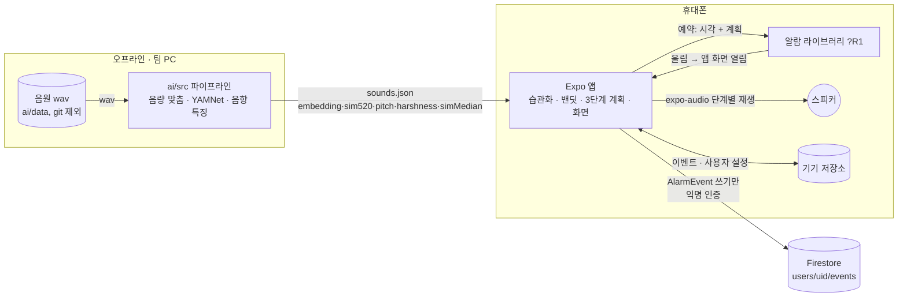
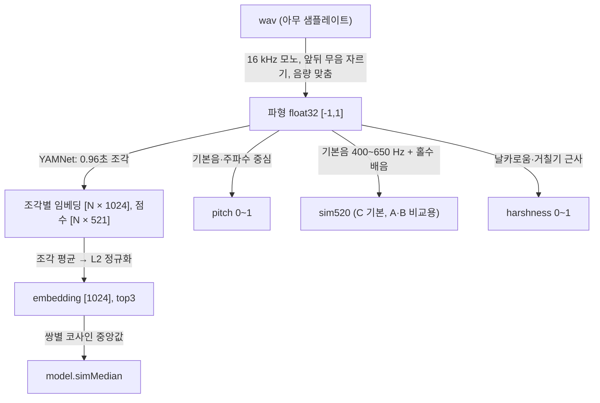
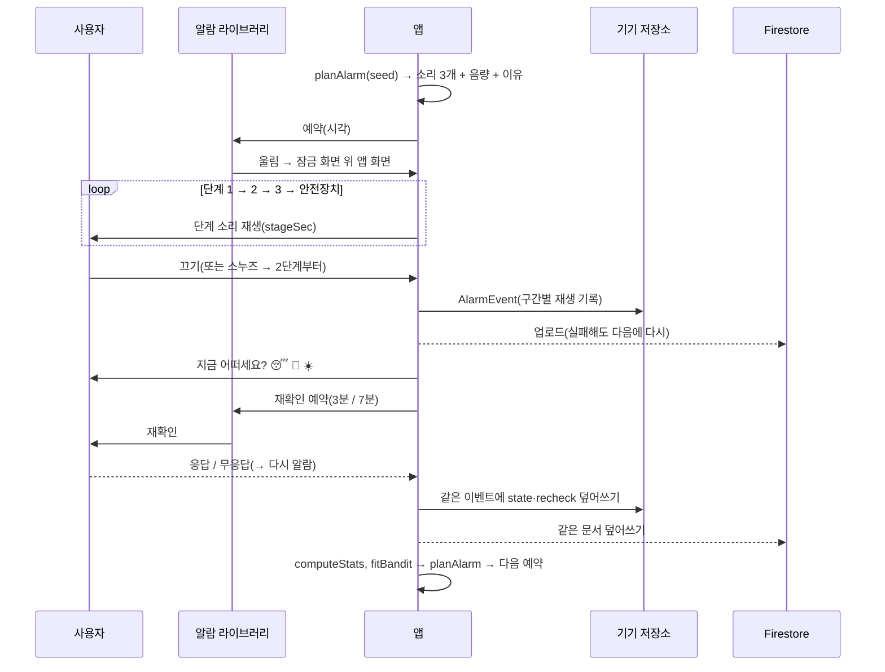

# 아빠 안잔다 — 설계

> 근거: [ai-design.md(PR #7)](https://github.com/lyw012012-cpu/appa-anjanda/pull/7)가 이 설계의 원안이다. 이 문서는 그 원안을 계약([contracts.md](contracts.md))으로 옮기면서 열린 곳의 기본값, PoC 범위, 일정, 심사 대응을 더한 것이다. 그 밖의 근거: 팀원 설명(YAMNet 구조), 근거 자료 캡처(Bruck·Thomas, McFarlane 2020).
> 원칙: 마감 2026-11-22, 제출물은 **기획안 + PoC**다. 결정마다 "실험 전 기본값"을 정해 바로 구현하고, 실험은 해당 이슈 안에서 돌려 기본값을 바꾼다(6절). PoC로 보이지 못한 것은 기획안에 "다음 단계"로 쓴다.

핵심: **YAMNet이 소리를 이해하고, 밴딧이 사람을 이해한다.** 사람마다 "어떤 성질의 소리가 나를 깨우나"를 반응 기록으로 학습하고, 알람 한 번에 소리 3개를 편안함 → 대비 → 낯섦 순서로 들려준다. 사람마다 다른 것은 **소리(밴딧)** 와 **구조(설정·규칙)** 두 층으로 맞춘다.

## 0. 틀

| 항목 | 내용 |
|---|---|
| 평가 기준 | 공고(링커리어 공고 페이지, 2026-11-18 확인): ① 문제 정의의 적합성 ② AI 활용의 적절성 ③ 서비스 구현 완성도 ④ 실제 활용 가능성. **배점·가점·기획안 형식은 [미확인]**(대회 홈페이지 ai-challenge.elice.page 확인 필요). 제출물: 기획안 및 PoC(11/14~22), 심사 11/23~12/10 |
| 기준별 대응 | ① 문제: 습관화 문헌 + 짧은 설문(I-14), "혐오감 없이, 반드시 깨운다"는 목표 ② AI: 소리 이해(YAMNet·음향 특징) + 사람 이해(밴딧), 무작위 돌리기와 비교한 시뮬레이션(I-13) ③ PoC: 3단계로 울리고 끈 뒤 확인까지 도는 앱 녹화(I-9) ④ 기기 안 계산(서버 연산 없음, Firestore는 보관용), 사람 유형 11가지 점검(1.6), 한계 정직하게 |
| 이해관계자 | 쓰는 사람(아침에 못 일어나는 사용자, 1.6의 유형별), 만드는 사람(3명), 평가(공모전 심사), 외부 의존(YAMNet 공개 모델, 음원 라이선스, 알람 라이브러리) |
| 작업 규칙 | 팀 레포 README: `main` 보호, `develop`에 PR, `feature/*`·`fix/*`, 커밋 접두어. 기본 브랜치는 `develop` |
| 완료의 정의 | `npm run check` 통과, PR 링크를 팀에 공유(리뷰는 선택), 화면 변경은 실행 화면 첨부, 실험이 걸린 이슈는 실험 결과 한 단락(6절 형식) |

## 1. 요구사항

### 1.1 목표

- **목적**: 혐오감을 주지 않는 적절한 소리로 편안하게 깨우되, 반드시 깨게 한다. 둘이 부딪히면 **반드시 깨는 쪽이 먼저**
- "적절한 소리" = 잘 깨우는 소리
- 흐름: ① 사용자가 마음에 드는 소리 선택 → ② 알람에서 깨는 반응 확인(몇 번째 소리에서 몇 초 만에, 끈 뒤 다시 잠들었나) → ③ 기록 축적 → ④ 소리 분배로 제공 → ②로 반복

**실패로 보는 것** (기술적으로 돌아가도)
- 사용자가 거슬려서 볼륨을 줄이거나 앱을 지운다
- AI의 시도 때문에 중요한 날 늦잠을 잔다
- 잠결에 끄고 다시 잠든 것을 "잘 깼다"로 배워 엉뚱한 소리를 강화한다
- 평균적인 사람에게만 맞고, 잠이 깊거나 예민한 사람에게는 매일 안전장치나 거친 소리가 울린다

### 1.2 범위

| PoC (반드시) | 기획안에만 (다음 단계) | 하지 않음 |
|---|---|---|
| 알람 예약, **3단계 재생**(편안함 → 대비 → 낯섦 → 안전장치), 끄기·스누즈 | 시작 단계 자동 조정, 아침/낮잠 구분, 부드러운 모드 | YAMNet 파인튜닝·재학습 |
| 끈 뒤 상태 질문(😴 🚶 ☀️)과 재확인 | 실데이터 분석(기록이 3명 × 며칠이라 결론 불가) | 끄기 미션(선택 기능 미션은 다음 단계) |
| 처음 설정(계열 대표 소리 고르기, 시작 음량), "이 소리 빼기", 기록은 기기에 저장하고 Firestore에 보관(익명 인증) | 거슬림 점수의 사람 평가 확인(E6) | 새 소리 생성(생성형 AI) |
| 습관화: **노출 기준**, 비슷한 소리로 번지고 시간이 지나면 회복(4.3) | PCA로 임베딩을 밴딧 입력에 넣기 | 휴대폰 위 신경망, iOS |
| **사람별 학습**: 특징 5개 선형 Thompson sampling 밴딧, 단계별 보상(4.4) | 통계 화면 고도화 | 수면 단계 측정 |
| 이유 한 줄, 시연용 통계 화면 | 세 쌍 비교로 거리 공간 고르기(E1, 시간이 남으면 PoC에) | — |
| 오프라인 파이프라인: 음량 맞춤, YAMNet 임베딩, 음향 특징(음높이 필수), 520 닮음, 거슬림 점수 | — | — |
| **시뮬레이션: 무작위 대 이 모델**, 사람 유형 ①②③⑥⑦(I-13) + 문제 근거 설문(I-14) | — | — |

**알람 경로 대안**: I-1에서 단계별 소리 바꾸기가 안 되면 알람마다 소리 하나(1단계만, 끌 때까지 반복)로 내리고, 같은 규칙을 알람 사이에서 적용한다(ai-design.md 8절, C5). 백그라운드 알람 자체가 11/19 정오까지 안 되면 포그라운드 경로로 PoC를 낸다(AD4).

### 1.3 사용자 스토리와 인수 조건

| ID | 스토리 | 인수 조건 (Given / When / Then) |
|---|---|---|
| US1 | 사용자로서 정해진 시각에 깨고 싶다 | 7:00 알람 / 7:00이 되면 / 5초 안에 1단계 소리가 울리고, 못 끄면 `stageSec`마다 2·3단계, 안전장치로 넘어간다 |
| US2 | 사용자로서 알람을 끄거나 미루고 싶다 | 울리는 중 / 끄기 / 멈추고 끈 단계·시간이 기록된다. 스누즈 / `snoozeMin` 뒤 2단계부터 다시, 2회를 넘으면 3단계부터 |
| US3 | 사용자로서 다시 잠들면 다시 깨워 주기를 바란다 | 끈 뒤 😴 / 3분 뒤 부드러운 재확인. 🚶·무응답 / 7분 뒤 "일어나셨나요?". 재확인에 응답 없음 / 다시 알람, 그 날의 보상을 낮춘다 |
| US4 | 사용자로서 익숙해진 소리로 다시 깨우지 않기를 바란다 | 소리 A를 여러 번 들음 / 3단계를 고를 때 / A와 비슷한 소리일수록 `pHabit`이 높아 "낯선 소리"에서 빠진다. 한 번도 안 울린 비슷한 소리도 포함(일반화). 한 번 들은 것만으로는 익숙해짐이 아니다 |
| US5 | 사용자로서 나를 잘 깨우는 성질의 소리로 깨고 싶다 | 기록이 쌓임 / 고를 때 / 이 사람이 잘 깬 성질(낮은 음, 520 닮음, 낯섦)에 무게가 옮겨 간다 |
| US6 | 사용자로서 거슬리는 소리는 듣고 싶지 않다 | 알람 화면에서 "이 소리 빼기" / 다음부터 / 그 소리는 어떤 단계에도 나오지 않는다. 1단계에는 거슬림 점수가 `comfortCap` 이하인 소리만 나온다 |
| US7 | 사용자로서 처음부터 내 취향을 반영하고 싶다 | 처음 설정에서 소리를 고름 / 1단계를 고를 때 / 고른 소리나 그와 비슷한 소리가 나온다 |
| US8 | 사용자로서 왜 이 소리인지 알고 싶다 | 다음 알람이 정해짐 / 알람 카드를 보면 / 소리 3개와 이유 한 줄이 보인다. 기록이 적으면 "아직 배우는 중"이라고 말한다 |

### 1.4 용어집

| 용어 | 뜻 | 코드 이름 |
|---|---|---|
| 단계 | 알람 한 번 안의 소리 순서. 1 편안함, 2 대비, 3 낯섦, 그다음 안전장치 | `Stage` |
| 구간 | 실제로 재생된 단계 하나. 스누즈 뒤 같은 단계가 다시 나올 수 있다 | `PlayedStage` |
| 노출 | 구간에서 들은 양. `playedSec / stageSec` | — |
| 습관화 강도 | 후보 소리에 쌓인 노출. 비슷한 소리에서 들은 것은 비슷한 만큼, 오래된 것은 줄여서 더한다 | `habitStrength` (H) |
| 익숙함 | `1 − exp(−H)`, 0~1 | `pHabit` |
| 520 닮음 | 520 Hz 사각파의 음향 성질(낮은 기본음 + 홀수 배음)을 얼마나 갖췄나, 0~1 | `sim520` |
| 음높이 | 기본음(없으면 스펙트럼 중심)을 소리 목록 안에서 0~1로. 0이 가장 낮음 | `pitch` |
| 거슬림 점수 | 날카로움·거칠기 근사치. 평균적 경향일 뿐 개인 혐오감이 아니다 | `harshness` |
| 특징 | 밴딧 입력 `[1, 단계 위치, 익숙함, 520 닮음, 음높이]` | `Features` |
| 보상 | 한 구간이 이 사람을 얼마나 깨웠나, 0~1 | `reward` |
| 가중치 | 이 사람에게 특징마다 얼마나 잘 깨우나. 사람별로 학습한다 | `BanditModel.mean` |
| 상태 질문 | 끈 직후 "지금 어떠세요?" 😴 🚶 ☀️ | `state` |
| 재확인 | 끈 뒤 몇 분 뒤의 확인. 응답이 없으면 다시 잠든 것으로 본다 | `recheck` |
| 임베딩 | YAMNet 1024칸 벡터의 조각 평균(L2 정규화) | `embedding` |

### 1.5 드라이버

| ID | 드라이버 | 종류 | 왜 구조를 바꾸나 |
|---|---|---|---|
| D1 | 앱이 꺼져 있어도 정해진 시각에 울리고, 잠금 화면 위로 앱 화면이 열려야 한다 | 핵심 기능 | 알람 라이브러리 + 개발 빌드가 필요하다(R1). 단계별 소리 바꾸기는 열린 앱 화면이 expo-audio로 한다 |
| D2 | 알람 한 번 안에서 단계마다 다른 소리·음량 | 핵심 기능 | 계획(소리 3개 + 음량)을 예약 전에 계산해 두고 재생은 앱이 한다(C5) |
| D3 | 익숙함은 노출에서, 잘 깨우는지는 사람 반응에서, 다시 잠들었는지는 재확인에서 | 핵심 기능 | 구간별 재생 기록 + 상태 질문 + 재확인 결과를 한 이벤트에 남긴다(C4) |
| D4 | 휴대폰에서 신경망을 돌리지 않는다 | 제약 | 소리 특징은 미리 계산(AD1). 사람별 학습은 5×5 행렬 연산이라 휴대폰에서 충분하다 |
| D5 | 남은 4일, 3명, 제출물은 기획안 + PoC | 제약 | 서버 연산 없이 기기 안에서 계산하고, Firestore는 쓰기만 하는 보관소로 둔다(AD6). 알람 경로는 시간 제한 후 대안(AD4) |
| D6 | 공모전 제출물의 음원 라이선스 | 제약 | 소리 목록을 앱에 번들하므로 출처·라이선스 칸이 계약에 들어간다 |

### 1.6 사람마다 다른 경우 (설계 점검 기준, ai-design.md 5절)

| # | 유형 | 이 설계가 하는 일 | 남는 위험 |
|---|---|---|---|
| ① | 잠이 깊은 사람 | 대부분 3단계에서 깸. 단계 위치 특징이 "뒤 단계라서 깼다"를 소리 공으로 세지 않음 | 낯선 소리를 빨리 소진, 안전장치가 일상이 됨 → 안전장치 비율을 지표로 봄. 2단계부터 시작은 다음 단계 |
| ② | 잠이 얕은 사람 | 1단계 몇 초 만에 깸. 시작 음량을 직접 정함 | 편안한 소리 안에서만 배움(문제 적음) |
| ③ | 늘 스누즈하는 사람 | 상수항이 이 사람의 기본값을 흡수해 소리 학습은 유지. 스누즈 상한 2회 | 잠결 스누즈를 막는 장치 없음 |
| ④ | 잠결에 끄고 다시 자는 사람 | 재확인이 몇 분 뒤 잡아 다시 깨우고 보상을 낮춤 | 재확인까지 몇 분은 다시 잠 |
| ⑤ | 수면이 불규칙한 사람 | 날마다 결과가 흔들려 학습이 느림 | **한계로 기록** |
| ⑥ | 고음이 잘 안 들리는 사람 | 음높이 특징으로 "저음에 잘 깸"을 배움. **개인화가 가장 효과 있는 경우**(8절 다 사례) | 음높이와 520 닮음이 함께 움직이면 가중치를 나눌 수 없음(R10) |
| ⑦ | 소리에 예민·불안한 사람 | "이 소리 빼기", 1단계 거슬림 상한 | 거슬림 점수가 이 사람에겐 안 맞을 수 있음. 부드러운 모드는 다음 단계 |
| ⑧ | 한 계열만 고른 사람 | 처음 설정에서 서로 다른 계열 2개 이상 권장 | 그 계열 전체가 함께 익숙해짐 |
| ⑨ | 소리를 안 고른 사람 | 선호 조건 없이 거슬림 상한 안에서 사전값으로 시작 | 시작값이 맞는지 시뮬레이션으로 확인 |
| ⑩ | 낮잠에도 쓰는 사람 | (다음 단계) 낮잠은 학습에서 뺀다 | PoC에서는 구분 없음 |
| ⑪ | 몇 달 쓴 사람 | 익숙함이 시간에 따라 회복되어 순환 | "바뀌는 알람" 자체에 적응할 수 있음 → **한계로 기록** |

### 1.7 품질 목표

모든 값은 [가설].

| ID | 품질 속성 시나리오 (자극 → 응답 → 측정) | 확인 방법 |
|---|---|---|
| Q1 | 예약 시각 도달 → 1단계 소리 재생 → 지연 5초 이내, 10회 중 10회 | 실기기 Android 1대, 2분 뒤 알람 10번 |
| Q2 | 계획 요청 → 3단계 계획 → 소리 50개, 이벤트 500개에 200 ms 이내 | 단위 테스트에서 시간 측정 |
| Q3 | 시뮬레이션 가상 사용자(①②③⑥⑦) → 이 모델이 무작위보다 그 사용자에게 맞는 소리를 더 자주 고르고, 안전장치까지 가는 비율이 줄어든다 | I-13(E5). 동작 확인용, 효과의 증거 아님 |
| Q4 | 계획 → 거슬림 상한을 넘거나 뺀 소리는 **어떤 단계에도 0회**, 1·2단계에 최근 3회 재생 소리 0회 | 단위 테스트 |
| Q5 | 시연: 처음 설정 → 알람이 1→2→3단계로 바뀌어 울림 → 끄고 😴 → 재확인 → 다음 계획과 이유가 바뀜 | 시연 녹화 |

**정직하게 적을 한계:** 효과는 대회 기간에 증명할 수 없다. 팀 기록은 3명 × 며칠이라 학습한 가중치는 사전값 근처에 머문다. 학습이 어떻게 움직이는지는 시뮬레이션으로 보이고, 실기기는 동작 확인으로만 쓴다. 습관화 식의 모양은 감각 습관화 일반의 문헌 근거이고 알람에서 직접 확인한 것이 아니다. "세기가 아니라 낯섦으로 깨운다"(탈습관화)도 같은 수준의 근거다.

### 1.8 가정·위험

| ID | 가정 | 틀리면 | 확인 방법 | 상태 |
|---|---|---|---|---|
| R1 | 앱이 꺼진 상태에서 예약 시각에 울리고, 잠금 화면 위로 앱 화면이 열리고, 그 화면에서 expo-audio로 소리를 바꿔 튼다 | 3단계 재생을 못 보인다 | Expo Go로는 직접 넣은 알림 소리가 안 된다(Expo Notifications 문서, 2026-11-16 확인). notifee는 2026-04 보관(archived) 처리돼 제외. **PR #10에서 react-native-alarm-scheduler로 프로토타입**: 예약 → 잠금 화면 위 앱 화면 → expo-audio 단계 재생, 기본 알람음은 hold로 잠시 끔(AD4). `player.replace`·`volume`은 SDK 58 문서에 있음. **실기기 확인 1~5는 11/19 정오까지**, 안 되면 대안(1.2) | 코드 있음, 실기기 [미확인] |
| R2 | YAMNet 임베딩 거리가 "사람이 느끼는 비슷함"을 대략 따른다 | 일반화·대비가 엉뚱하게 잡힌다 | 쌍별 코사인 중앙값을 뺀다(4.3). PR #7 6.2: YAMNet은 음높이에 둔하고 리듬·종류를 본다 → 음높이는 별도 특징으로. 시간이 남으면 E1 | [미확인] |
| R3 | 520 닮음을 0~1로 의미 있게 잴 수 있다 | 520 특징이 장식이 된다 | E2. 기본 방식 C(PR #7 6.2 근거) | [미확인] |
| R4 | 끄기까지 걸린 시간·스누즈·재확인 응답이 "이 소리가 이 사람을 얼마나 깨웠나"를 나타낸다 | 피곤한 날·스누즈 습관을 소리 탓으로 배운다 | 상수항이 사람별 기본 수준을 흡수. 보상은 "깼나"(0 대 0.5 이상)를 먼저 가르고 시간은 0.5~1 안에서만 더함. 상태 응답은 보상에 쓰지 않음(잠결의 자기 판단은 믿기 어려움) | [가설] |
| R5 | 520 Hz 사각파가 더 잘 깨운다 | 520 특징의 근거가 약해진다 | 문헌은 "그 신호"가 잘 깨운다는 것이고 "닮을수록"은 이 설계의 가설 → 고정 점수가 아니라 **사전값**으로만 쓰고 학습이 덮어쓴다 | 근거 약함, 가설로 명시 |
| R6 | 라이선스 문제 없는 알람 음원 15개 이상, 계열마다 3개 이상 | 후보가 적어 단계별 조건이 자주 풀린다 | I-3. 부족하면 합성음으로 채운다 | [미확인] |
| R7 | 감각 습관화의 성질(반복 노출, 일반화, 회복, 탈습관화)이 알람 소리에도 성립한다 | 4.3 식과 3단계의 근거가 약해진다 | 문헌(7절). 앱 안에서는 검증하지 않는다 | 일반 근거 있음, 알람 직접 근거 없음 |
| R8 | 같은 알람에 익숙해져 못 일어나는 경험이 흔하다 | 심사 기준 ①이 약해진다 | I-14 설문(10~20명) + 문헌 | [미확인] |
| R9 | 소리 파일마다 음량이 달라도 비교가 공정하다 | "잘 깨움"을 배운 것이 음량 차이다 | 파이프라인에서 음량을 맞추고, 깨우는 크기는 단계별 재생 음량이 정한다. 음량을 단계마다 고정하지 않고 흔들어 "커서 깼나 / 3단계라서 깼나"를 구분한다 | 대응함 |
| R10 | 음높이와 520 닮음(방식 C)이 따로 움직인다 | 둘 다 기본음에서 나와 함께 움직이면 밴딧이 가중치를 나눌 수 없고 이유 한 줄이 흔들린다 | I-2에서 소리 목록의 두 값 상관을 계산. 높으면(\|r\| > 0.7 [가설]) 하나를 뺀다(C4 `Features` 변경) | [미확인] |
| R11 | 미디어 볼륨 0이어도 알람이 들린다 | expo-audio가 미디어 볼륨을 쓰면 아무 소리도 안 난다 | I-1(ai-design.md 8절 4). 안전장치는 라이브러리 기본 알람음(알람 볼륨): 앱 단계가 끝나거나 앱이 죽어 hold 연장이 끊기면 저절로 울린다(PR #10) | 완화책 있음, 실기기 [미확인] |

## 2. 그림

### 2.1 사용자 흐름

1. 처음 열면 처음 설정: 계열 대표 소리 6개 정도를 듣고 고른다(서로 다른 계열 2개 이상 권장), 시작 음량을 정한다, 권한 안내
2. 알람 시각을 정한다. 앱이 3단계 계획(소리·음량·이유)을 만든다
3. 시각이 되면 1단계가 울리고, 못 끄면 2·3단계, 안전장치로 넘어간다
4. 끄면 "지금 어떠세요?" → 상태에 따라 재확인을 예약한다
5. 재확인 결과까지 붙은 기록으로 습관화와 사람별 가중치를 다시 계산한다
6. 다음 계획을 만들어 예약을 바꾼다
7. 3~6 반복

### 2.2 컨테이너 다이어그램



- 파이프라인: 소리 특징을 만든다 / 사용자 데이터로 학습하지 않는다
- 앱: 벡터 연산과 5×5 행렬 연산만 한다 / 신경망을 돌리지 않는다(D4)
- 서버 연산 없음. 기록은 기기에 먼저 저장하고 Firestore에 올린다. 앱은 Firestore를 읽지 않는다(AD6, M3)

### 2.3 데이터 흐름도



PR #7 6.1에서 확인: Python 3.13 + TensorFlow 2.21에서 520 Hz 사각파 3초 → 임베딩 `(6, 1024)`, 점수 `(6, 521)`.

### 2.4 시퀀스: 알람 한 번



**`?`로 남은 곳(→ R1):** 앱이 꺼져 있을 때 끝난 알람의 판정. 다음 실행 때 `reconcile`이 소급한다(C5).

## 3. 아키텍처 결정

스타일: **모바일 앱 + 오프라인 전처리(파이프 앤 필터)**. 서버 연산 없음, Firestore는 보관용.

| ID | 결정 | 얻는 것 | 감수하는 것 → 완화 | 관련 |
|---|---|---|---|---|
| AD1 | 소리 특징은 **오프라인에서 미리 계산**해 `sounds.json`으로 번들 | 계산 빠름, 휴대폰 모델 탑재 위험 제거 | 사용자가 새 음원을 못 넣는다 → 다음 단계 | D4 |
| AD2 | AI 두 층. **소리 이해**: YAMNet(학습된 그대로) + 음향 특징. **사람 이해**: 특징 5개 선형 Thompson sampling 밴딧, 기록 전체로 매번 다시 계산(상태 저장 안 함). 익숙함·거슬림·순서 규칙은 학습하지 않는다 | 데이터가 적어도 동작, 가중치를 설명에 쓸 수 있음, 휴대폰에서 행렬 연산만, 같은 기록이면 같은 결과 | 대회 기간 기록으로는 가중치가 사전값 근처 → 시연은 시뮬레이션(I-13). 이유 한 줄은 학습량이 적으면 "아직 배우는 중"이라고 말한다(C8 규칙 13) | D3·D4·R4·R5 |
| AD3 | 520 닮음은 세 방식을 다 계산하고 기본은 방식 C | YAMNet이 음높이에 둔하다는 실험 결과(PR #7 6.2)에 맞음 | 음높이가 바뀌는 소리에서 불안정 → E2 | R3 |
| AD4 | 알람 경로: **EAS 개발 빌드** + `react-native-alarm-scheduler`(PR #10)가 울리면 잠금 화면 위로 앱 화면, 앱이 expo-audio로 단계별 재생. 그동안 기본 알람음은 **hold**(30초, 20초마다 연장)로 끄고, 단계가 끝나거나 앱이 죽어 연장이 끊기면 기본 알람음이 안전장치로 울린다. 재확인은 라이브러리의 followUp 알람. I-1을 **11/19 정오까지**로 제한하고, 단계 바꾸기가 안 되면 알람마다 소리 하나, 백그라운드가 안 되면 포그라운드 경로로 PoC. C5 함수 모양은 모든 경로에서 같다 | 시연이 R1에 막히지 않는다 | 대안 경로는 실제 알람 앱으로 부족 → 기획안에 남은 위험으로 적는다 | D1·D2·R1·R11 |
| AD5 | 실험으로 바뀔 값은 **설정 파일 하나**(`app/src/config.ts`, [contracts.md C9](contracts.md#c9-설정-실험으로-바뀌는-값)) | 실험 결과를 PR 한 줄로 반영 | — | 6절 |
| AD6 | 기록은 **기기에 먼저 저장**하고 Firestore(`users/{uid}/events`, 익명 인증)에 **쓰기만** 한다. 추천은 기기 기록으로만 계산하고 앱은 Firestore를 읽지 않는다. 사용자 설정은 기기에만 (팀 결정, PR #10에서 구현) | 오프라인에서도 동작, 팀 기록을 시연·기획안 근거로 모을 수 있음, 익명 로그인은 AsyncStorage에 남아 재실행해도 같은 uid | 개인정보(기상 시각)가 서버에 감 → 익명 uid, 자기 경로만 쓰는 보안 규칙. 기록이 3명 × 며칠이라 분석 결론은 내지 않는다 | D3·D5 |
| AD7 | 거리 공간은 `sounds.json`의 `embedding`에 넣고 앱은 어떤 공간인지 모른다. 기본 YAMNet | 앱 코드 변경 없이 공간 교체 | 바꾸면 파이프라인을 다시 돌린다 | R2 |

**하지 않음**: YAMNet 파인튜닝·재학습(데이터 15~30개로는 거의 안 바뀌고, 휴대폰에서 신경망을 돌리지 않아 사람마다 할 수도 없다), 학습을 위한 학습(거리 보정·거슬림 예측 학습), 끄기 미션(편안함과 일정 때문에, "정말 깼나"는 상태 질문·재확인이 맡는다).

## 4. 상세 설계

### 4.1 두 층의 개인화

| 층 | 무엇을 맞추나 | 어떻게 |
|---|---|---|
| 구조 개인화 | 시작 음량, 고른 소리, 뺀 소리 | 처음 설정 + "이 소리 빼기"(규칙) |
| 소리 개인화 | 어떤 성질의 소리가 이 사람을 깨우나 | 밴딧 학습 |

**AI가 학습하지 않는 것**: 소리 특징·거슬림 점수(오프라인 고정), 익숙함(식), 순서 규칙·구조 개인화(규칙).

### 4.2 알람 한 번의 순서

```
1단계  편안한 소리   고른 소리와 비슷, 거슬림 ≤ comfortCap, 시작 음량      ← Thompson 표본으로 고름(시도 포함)
2단계  대비 소리     1단계와 다름(sim ≤ contrastMaxSim), 거슬림 ≤ harshCap,  ← Thompson 표본으로 고름(시도 포함)
                    음량 한 단계 위
3단계  낯선 소리     pHabit < habituatedAt + 1·2단계와 다름 + 거슬림 상한,   ← 사후 평균으로 고름(시도 없음)
                    음량 한 단계 위(maxVolume 이하)
안전장치            3단계도 실패하면 라이브러리 기본 알람음
```

- 3단계는 **세기가 아니라 낯섦**으로 깨운다. 근거: 습관화 연구의 탈습관화(새 자극이 반응을 되살림)
- 음량은 단계마다 `volumeStep`씩 올리고 ±`volumeJitter` 흔들어 "커서 깼나 / 3단계라서 깼나"를 구분한다
- 최근 제외는 1·2단계에만, "이 소리 빼기"와 거슬림 상한은 모든 단계에, 그리고 **절대 풀지 않는다**
- 후보가 비면 `recent` → `contrast` → `habituated` 순서로 풀고 기록한다
- 대비를 재는 방법은 [ai-design.md](https://github.com/lyw012012-cpu/appa-anjanda/pull/7) 12절에서 열린 결정이었다. **기본값은 임베딩 거리**로 두고(가장 단순하고 이미 계산됨) I-13에서 다른 축과 비교한다 [가설]
- 정확한 규칙은 [contracts.md C8](contracts.md#c8-추천-모듈-b-제공-c10화면이-사용) 규칙 7~12

### 4.3 익숙함 (노출 기준)

```
sim(a, b) = 1                                         (a = b)
          = clip((max(0, cos) − m) / (1 − m), 0, 1)     (a ≠ b, m = simMedian)
H(c)      = Σ_구간 p  exposureGain · (p.playedSec / stageSec) · sim(c, p.soundId) · exp(−(now − p.startedAt) / tauDays)
pHabit(c) = 1 − exp(−H(c))
```

습관화는 반복 **노출**로 생긴다. 결과의 좋고 나쁨은 보상(4.4)이 따로 다룬다. 중앙값을 빼는 이유: 합성 소리 9개에서 서로 다른 소리끼리도 코사인 중앙값이 0.58이었다(PR #7 6.2). 그대로 쓰면 익숙함이 모든 소리로 넓게 번져 3단계의 "낯선 소리"를 고르지 못한다.

| 식의 항 | 습관화 성질 |
|---|---|
| `exposureGain · playedSec / stageSec` | 반복 자극에 반응이 줄어든다 |
| `sim(c, p.soundId)` | 비슷한 자극으로 일반화된다 |
| `exp(−Δt / tauDays)` | 자극을 쉬면 자발적으로 회복된다 |
| `1 − exp(−H)` | 반복할수록 감소 폭이 줄어 한계에 다가간다 |

**`exposureGain` 0.5, `tauDays` 3일, 한 단계 전부(30초) 들었을 때** (코드로 계산):

| 상황 | `pHabit` |
|---|---|
| 한 번 들은 뒤 0 / 1 / 3 / 7 / 14일 | 0.3935 / 0.3011 / 0.1680 / 0.0473 / 0.0047 |
| 3일 연속 들은 다음 날 | 0.5502 → 익숙해짐(`habituatedAt` 0.5) |
| 같은 날 1분(두 구간) 들은 것이 이틀 | 0.7077, 코사인 0.6인 비슷한 소리 0.5219 |

### 4.4 보상과 사람별 학습

**특징** `x(c, s) = [1, (s − 1)/2, pHabit(c), sim520n(c), pitch(c)]`

| 특징 | 왜 |
|---|---|
| 상수 1 | 이 사람의 기본 깨움 정도(늘 스누즈하는 사람 등을 흡수, ③) |
| 단계 위치 | 뒤 단계는 앞 소리 때문에 원래 잘 깬다. 그 몫을 소리 공으로 세지 않는다(①) |
| 익숙함 | 익숙해서 실패한 것을 "궁합 나쁨"으로 오해하지 않는다 |
| 520 닮음 | 문헌의 평균적 "잘 깨움"(사전값만, R5) |
| 음높이 | 고음이 안 들리는 사람(⑥). YAMNet이 놓치는 성질 |

**보상** (재생된 구간마다)

| 상황 | 보상 |
|---|---|
| 이 단계가 끝날 때까지 반응 없음 | 0 |
| 이 단계에서 끔 | `0.5 + 0.5 × exp(−그 구간에서 끄기까지 걸린 초 / 10)` |
| 다음 단계 시작 후 `graceSec`(5초) 안에 끔 | 앞 단계에 공을 줌(폰을 집는 시간), 뒤 구간은 학습에서 뺌 |
| 이 단계에서 스누즈 | 0.3 |
| 끝까지 못 끔 | 모든 구간 0 |
| 재확인에 응답 없음(다시 잠듦) | 끈 구간의 보상을 0.2로 |

- 0과 0.5 이상의 차이가 "깼나"를 정하고, 시간은 0.5~1 안에서만 더한다
- **혐오감은 보상에 넣지 않는다.** 섞으면 "잘 깨웠지만 싫었다"를 구분할 수 없다. 혐오감은 상한과 "이 소리 빼기"로 다룬다
- 상태 응답(😴 🚶 ☀️)은 보상에 쓰지 않고 재확인 여부와 기록에만 쓴다

**학습**: 사전값 `θ ~ N(μ0, v0·I)`, 관측 `reward = θ·x + 잡음`. 사후값은 닫힌 식(contracts C8 규칙 5). 사전값 `μ0 = [0.2, 0.3, −0.5, 0.5, 0]`은 "익숙할수록 나쁨, 520 닮을수록 좋음, 뒤 단계일수록 잘 깸, 음높이는 모름"이고 I-13에서 조정한다. Thompson 표본은 `seed`로 만든 결정적 난수로 뽑아 같은 입력이면 같은 계획이 나온다(M2).

### 4.5 끈 뒤: 상태 질문과 재확인

```
끄기 → "지금 어떠세요?"
   😴 아직 졸려요      → 3분 뒤 부드러운 소리로 재확인
   🚶 일어나는 중이에요 → 7분 뒤 알림 "일어나셨나요?"
   ☀️ 완전히 깼어요    → 끝
   (응답 없음)         → "일어나는 중"과 같게
재확인에 응답 없음 → 다시 잠든 것으로 보고 다시 알람 + 보상 낮춤
```

상태 응답과 재확인 결과가 얼마나 자주 어긋나는지 기록해 기획안의 근거로 쓴다.

### 4.6 AI가 내놓는 것

| 결과물 | 쓰이는 곳 |
|---|---|
| 소리 3개 순서 + 단계별 음량 | 알람 재생 |
| 단계별 예상 깨움 점수(`predicted`) | 고르는 기준, 통계 화면 |
| 이유 한 줄 | 알람 카드. 학습량이 `reasonMinN` 미만이면 "아직 배우는 중"(이유가 사전값을 사용자 학습처럼 보이게 하지 않으려고) |
| 사람별 프로필(특징별 가중치·학습량) | 통계 화면, 발표 시연 |

### 4.7 데이터 계약

사람 사이를 오가는 데이터·함수·파일·저장 위치는 전부 [contracts.md](contracts.md)에 있다.

## 5. 테스트 전략

| 대상 | 수준 | 데이터 | 자동 |
|---|---|---|---|
| 습관화·3단계 고르기·보상·사후값(4.2~4.4) | 단위 | [contracts.md 8절](contracts.md#8-가짜-데이터-먼저-시작하는-사람용) 가~다(`bandit.mode: 'mean'`) | 예 |
| Thompson·음량 흔들림 | 단위 | 8절 라: 같은 `seed`면 같은 계획, 규칙 위반 0 | 예 |
| 거슬림 상한·뺀 소리는 절대 안 나옴(Q4) | 단위 | 8절 나 | 예 |
| `sounds.json` 모양 | 단위 | 파이프라인 출력 | 예(파이프라인과 앱 로더가 둘 다 C2 검사) |
| 무작위 대 모델 | 시뮬레이션 | 유형 ①②③⑥⑦ × 14일(I-13) | 예, 그래프 |
| Q1 알람 지연, 단계 바꾸기, 재확인, 미디어 볼륨 0 | 실기기 | I-1 | 아니오, 표로 기록 |
| Q5 시연 | 실기기 | 처음 설정 → 3단계 → 😴 → 재확인 | 아니오, 녹화 |

합성·가짜 데이터로 확인되는 것은 "코드가 맞게 계산한다"까지다. 시뮬레이션은 "학습이 이렇게 움직인다"를 보여 줄 뿐 효과의 결론이 아니다. 시뮬레이션은 앱의 `planAlarm`을 그대로 부른다(파이썬 재구현 금지, 두 구현이 어긋나는 위험).

## 6. 구현하면서 하는 실험

| ID | 질문 | 실험 전 기본값 | 어느 이슈에서 | 재는 것 / 판단 기준 | 결과로 바뀌는 것 |
|---|---|---|---|---|---|
| E0 | (R1·R11) 꺼진 앱에서 울리나, 잠금 화면 위로 열리나, 단계별로 소리를 바꿔 트나, 미디어 볼륨 0이면, 재확인 알림을 받나 | 개발 빌드 + 알람 라이브러리 + expo-audio | I-1 (11/19 정오까지) | 실기기 10회: 맞는 소리 비율, 지연, 단계 전환, 볼륨 0 | AD4 경로(3단계 / 소리 하나 / 포그라운드). **다른 일보다 먼저** |
| E1 | (R2) 거리 공간 후보 중 사람 판단과 가장 맞는 것은? | YAMNet | I-12 (시간이 남으면) | 팀 3명 × 같은 30문항 세 쌍 비교. 다른 공간이 10%p 이상 높지 않으면 YAMNet 유지 | `model.space` |
| E2 | (R3) 520 닮음 A·B·C 중 무엇이 쓸 만한가, (R10) 음높이와 상관 | C | I-2 | 대조 소리 5개의 순위가 음향 성질로 정한 기대 순서와 맞나. 소리 목록에서 `sim520.hand`와 `pitch`의 상관 | `sim520Method`, 특징 구성 |
| E5 | (Q3, 심사 ②) 이 모델이 무작위보다 나은가, 사전값·`exposureGain`·`tauDays`·보상 값·대비 방법은 적당한가 | C9 기본값 | I-13 | 유형 ①②③⑥⑦ 가상 사용자 14일씩, 무작위·학습 없는 규칙(`priorVar` → 0)·이 모델을 같은 시드로. 깬 단계 평균, 안전장치 비율, 다시 잠든 비율, 쓴 소리 수, 가중치가 정답 쪽으로 가는지(특히 ⑥의 음높이), 남은 낯선 소리 수 | C9 값, 발표 그림 |

삭제한 실험: E3(분류기 비교)은 밴딧이 대신하고, E4(실데이터 임계값)는 기록이 3명 × 며칠이라 결론을 낼 수 없어 뺐다. 상태 응답과 재확인의 어긋남은 기록만 남긴다. E6(거슬림 사람 평가)은 다음 단계.

결과 기록 형식: 무엇을 / 어떻게 / 결과 / 바뀐 결정. 해당 PR 본문에 남긴다.

## 7. 근거 자료 요약

| 근거 | 내용 | 강도 |
|---|---|---|
| Bruck·Thomas 연구팀 | 520 Hz 사각파가 3100 Hz 순음이나 일반 고음 경보보다 깨우는 데 효과적이라고 반복 보고 | 실험실 연구, 표본 작음. "그 신호"에 대한 근거이고 "닮을수록"은 가설(R5) |
| McFarlane 2020 | 멜로디가 있는 알람이 기상 직후 멍함(수면 관성) 감소와 관련 | 50명 자기보고 설문, 유의하지 않은 결과도 함께 있음 → 약함. 1단계 "편안한 소리"의 보조 근거 |
| Thompson·Spencer 1966 | 습관화의 성질: 반복 자극에 반응 감소, 비슷한 자극으로 일반화, 쉬면 회복, 새 자극이 반응을 되살림(탈습관화) | 고전 정리 논문 |
| Rankin 외 2009 | 위 성질들을 다시 검토한 합의 문서(Neurobiology of Learning and Memory) | 감각 습관화 일반. 알람 직접 근거는 아님(R7) |
| I-14 설문 | 같은 알람에 익숙해져 못 일어난 경험의 빈도 | 아직 안 함, 작은 표본의 보조 근거 |
| PR #7 6.2 합성 소리 실험 | YAMNet은 음높이에 둔하고, 로그 멜 평균은 무음·음량에 끌려가며, 서로 다른 소리끼리도 코사인 중앙값 0.58 | 이 팀이 직접 돌린 결과, 합성 소리 9개 |

[미확인] 네 논문 원문(서지 정보·수치)은 아직 직접 확인하지 않았다. 발표에 넣기 전에 원문을 확인한다(D10).
