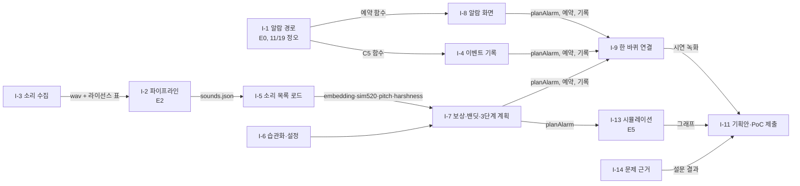

# 아빠 안잔다 — 이슈 초안

> 아직 등록하지 않았다. 등록 직전에 열린 이슈를 다시 조회해 중복을 막는다. 이슈 본문에서 설계 내용은 [design.md](design.md), 모양·함수·저장 위치는 [contracts.md](contracts.md) 절 링크로 가리킨다. **이슈 하나가 계약 하나 이상을 구현하고, 계약과 다르게 만들 일이 생기면 계약 변경 PR부터 올린다**(contracts.md 9절).

## 제출물과 범위

제출: **기획안 + PoC**, 마감 2026-11-22. 심사 기준 네 가지(design.md 0절)에 맞춰 PoC로 보일 것만 만든다.

| 심사 기준 | 이걸 보여 주는 이슈 |
|---|---|
| ① 문제 정의 | I-14 설문·문헌 |
| ② AI 활용 | I-2(소리 이해), I-6·I-7(습관화·사람별 학습), **I-13(무작위 대 모델)** |
| ③ 구현 완성도 | I-1·I-4·I-8·I-9 → 시연 녹화(처음 설정 → 3단계 → 😴 → 재확인) |
| ④ 실제 활용 | I-11 기획안(사람 유형 11가지 점검, 기기 안 계산, 한계, 다음 단계) |

설계 원안은 [ai-design.md(PR #7)](https://github.com/lyw012012-cpu/appa-anjanda/pull/7). PoC 범위 = [design.md 1.2](design.md#12-범위)의 "PoC" 열(3단계 재생, 상태 질문·재확인, 처음 설정, "이 소리 빼기", 노출 기준 습관화, 특징 5개 밴딧) + 6절 실험 E0·E2·E5. 시간이 남으면 I-12(E1).
다음 단계(기획안에만): 시작 단계 자동 조정, 아침/낮잠 구분, 부드러운 모드, 거슬림 사람 평가, iOS.

## 담당 제안 (오늘 확정)

| 사람 | 영역 | 이슈 | 지금 시작 가능 |
|---|---|---|---|
| A | 앱: 알람·재확인·화면 | I-1, I-4, I-8, I-9 | I-1 (11/19 정오까지 시간 제한) |
| B | 앱: 습관화·밴딧·3단계 계획·시뮬레이션 | I-5, I-6, I-7, I-13 | I-6, I-7 (8절 가짜 데이터로) |
| C | AI: 소리·파이프라인·근거 | I-2, I-3, I-14, (I-12) | I-2, I-3, I-14 |
| 전원 | 기획안·발표 | I-11 | — |

## 의존성 그래프

화살표 = "먼저 있어야 함", 라벨 = 넘겨주는 것.

I-2·I-3은 동시에 시작한다: 파이프라인은 대조 소리 5개(합성 + 아무 무료 음원)로 먼저 만들고, 수집된 소리가 오면 다시 돌린다. I-6·I-7은 [contracts.md 8절 가짜 데이터](contracts.md#8-가짜-데이터-먼저-시작하는-사람용)로 먼저 만든다. A의 화면(I-8)도 같은 가짜 데이터로 먼저 시작할 수 있다.

## 마일스톤

| 마일스톤 | 기한 | 이슈 | 끝나면 보이는 것 |
|---|---|---|---|
| M1 경로·계약 | 11/19 | I-1, I-3, I-6, I-14(설문 배포) | 알람 경로 확정(백그라운드 / 포그라운드), 계약 테스트 통과 |
| M2 한 바퀴 | 11/20 | I-2, I-4, I-5, I-7, I-8, I-9 | 처음 설정 → 3단계로 울림 → 끈 뒤 확인 → 다음 계획과 이유가 바뀌는 앱 |
| M3 근거 | 11/21 | I-13, I-14(정리), (I-12) | 무작위 대 모델 그래프, 설문 결과 |
| 제출 | 11/22 | I-11 | 기획안 + PoC(시연 녹화) |

라벨: `area:app-alarm` `area:app-recommend` `area:ai` `experiment` `chore`

---

## I-0 레포 설정과 평가표 확인 `chore`

### 이 이슈는
README와 실제 설정이 다른 곳을 맞추고, 평가 기준 원문을 확인한다.

### 할 일
- [x] GitHub 기본 브랜치를 `develop`으로 변경
- [x] 공고의 심사 기준 네 가지를 design.md 0절에 기록(2026-11-18, 링커리어 공고)
- [ ] 대회 홈페이지(ai-challenge.elice.page)에서 배점·기획안 형식 확인 → design.md 0절
- [x] `app.json`의 `name`·`slug`·`scheme`을 템플릿 값 `app`에서 프로젝트 이름으로 (PR #6)
- [x] README의 "React Native Reusables 우선 사용"을 실제 설치 여부에 맞게 정리 (PR #6)
- [ ] README 기술 표를 실제와 맞추기(서버 연산 없음·Firestore 보관, AI는 TensorFlow·YAMNet) (PR #6 리뷰)

### 완료 조건
- [ ] design.md 0절에 배점·형식이 채워지거나 "공개 안 됨"으로 확인됨

## I-1 알람 경로: 지정한 소리로 울리고 결과 받기 `area:app-alarm` `experiment`

### 이 이슈는
설계 전체가 기대는 가정 R1·R11을 확인한다(실험 E0, [ai-design.md](https://github.com/lyw012012-cpu/appa-anjanda/pull/7) 8절). **11/19 정오까지로 시간을 제한한다.** 결과에 따라 셋 중 하나로 정하고 팀에 바로 알린다([design.md AD4](design.md#3-아키텍처-결정)): ① 3단계 재생 ② 알람마다 소리 하나 ③ 포그라운드 경로. 어느 경로든 C5 함수 모양은 같다.
- 먼저 필요: 없음(지금 시작 가능)
- 이게 끝나면: I-4, I-8

### 할 일
- [ ] EAS 개발 빌드(`app/android`를 만들지 않음), 알람 라이브러리 후보(PR #10에서 react-native-alarm-scheduler로 프로토타입. notifee는 2026-04 보관 처리돼 제외)의 유지 여부·SDK 58 호환·Android 14 권한 확인(`app/AGENTS.md` 규칙: 기억 말고 문서)
- [ ] 확인 1: 앱이 꺼진 상태에서 예약 시각에 울리나
- [ ] 확인 2: 울릴 때 잠금 화면 위로 앱 화면이 열리나
- [ ] 확인 3: 열린 화면에서 expo-audio로 소리 2개를 바꿔 트나(`player.replace`, `volume`)
- [ ] 확인 4: **미디어 볼륨 0일 때** 어떻게 되나(R11). 안전장치는 라이브러리 알람 볼륨으로
- [ ] 확인 5: 재확인 알림을 몇 분 뒤에 띄우고 응답을 받나
- [ ] 대안 ③ 포그라운드 경로: 알람 화면을 켜 둔 상태에서 시각이 되면 expo-audio로 단계별 재생
- [ ] 고른 경로로 10회 측정 → [E0](design.md#6-구현하면서-하는-실험) 결과 기록

### 완료 조건
- [ ] 확인 1~5 결과 표(맞는 소리 비율, 지연, 단계 전환, 볼륨 0)와 결론 한 단락: 고른 경로와 이유
- [ ] 소리 파일 형식·위치를 정해 [contracts.md 10절](contracts.md#10-아직-열린-곳)과 C3 수정 PR

## I-2 오프라인 파이프라인: sounds.json 만들기 `area:ai` `experiment`

### 이 이슈는
소리마다 음량을 맞추고 YAMNet 임베딩과 520 닮음을 미리 계산해 앱에 넘긴다(AD1). 실험 E2를 여기서 한다.
- 먼저 필요: 없음(대조 소리로 시작 가능). I-3이 끝나면 다시 실행
- 이게 끝나면: I-5

### 할 일
- [ ] 환경: Python 3.13 + TensorFlow 2.21 + tensorflow-hub(PR #7 6.1). `requirements.txt`에서 쓰지 않는 `torch`를 빼고 TensorFlow 쪽 의존성 추가
- [ ] 읽기: 16 kHz 모노, 앞뒤 무음 자르기, **음량 맞추기**([C3](contracts.md#c3-소리-파일과-자산-목록-파이프라인--앱))
- [ ] YAMNet 임베딩(조각 평균 → L2 정규화), `top3`
- [ ] 음향 특징: `pitch`(기본음, 없으면 스펙트럼 중심), `harshness`(날카로움·거칠기 근사) — 계산식을 PR에 적는다([C2](contracts.md#c2-soundsjson-파이프라인--앱))
- [ ] `sim520` 세 방식 계산, 기본 C. B는 평균을 뺀 로그 멜로
- [ ] `model.simMedian`(쌍별 코사인 중앙값) 계산과 쌍별 코사인 분포 그림
- [ ] `sim520.hand`와 `pitch`의 상관(R10). \|r\| > 0.7이면 팀에 알리고 특징 하나를 빼는 계약 PR
- [ ] `sounds.json`·소리 파일·`sound-assets.ts` 출력([C2](contracts.md#c2-soundsjson-파이프라인--앱)·[C3](contracts.md#c3-소리-파일과-자산-목록-파이프라인--앱)) + C2 규칙 assert
- [ ] E2: 대조 소리 5개 순위 표

### 완료 조건
- [ ] 코사인 분포·E2 순위 표가 PR에 있고 결론 한 단락

## I-3 소리 목록 수집 `area:ai`

### 이 이슈는
추천 후보가 될 알람 음원 15~30개를 라이선스와 함께 모은다(D6, R6).
- 먼저 필요: 없음(지금 시작 가능)
- 이게 끝나면: I-2 재실행

### 할 일
- [ ] 출처·라이선스·계열(`group`)·계열 대표(`group_rep`) 표 작성. 계열은 벨·멜로디·경보·자연음·음성 등 4~6종, 계열마다 3개 이상(대비·낯섦 단계에 후보가 남도록). 모자라면 합성음(사각파·삑-쉼 패턴)으로 채운다
- [ ] 원본은 `ai/data/`(git 제외), 공유는 팀 드라이브

### 완료 조건
- [ ] 라이선스 표에 빈 칸 없음

## I-4 이벤트 기록 `area:app-alarm`

### 이 이슈는
알람마다 구간별 재생 기록과 사용자 설정을 기기에 저장한다(D3, AD6). 습관화와 사람별 학습의 재료다.
- 먼저 필요: I-1(결과 콜백). 계약은 정해져 있으니 저장 부분은 먼저 시작 가능
- 이게 끝나면: I-9

### 할 일
- [ ] 저장소([C7](contracts.md#c7-저장소-a-제공-bc10이-사용)): 이벤트 `appa.events.v2`, 사용자 설정 `appa.settings.v1`, 시연용 `clearEvents`
- [ ] Firestore 업로드 `syncPending`([C11](contracts.md#c11-firestore)). 익명 인증·보안 규칙은 PR #10에 있음
- [ ] 결과 판정([C6](contracts.md#c6-결과-판정-규칙-a가-c5-안에서-적용)): 구간마다 `playedSec`·`end`를 정확히

### 완료 조건
- [ ] 알람 3회 뒤 앱을 다시 켜도 이벤트 3개가 남아 있다(화면 캡처)

## I-5 소리 목록 로드 `area:app-recommend`

### 이 이슈는
`sounds.json`과 소리 파일을 앱에 넣고 C2 규칙을 검사한다.
- 먼저 필요: I-2(진짜 파일). 계약 예시로 먼저 시작 가능
- 이게 끝나면: I-7

### 할 일
- [ ] `loadSoundLibrary()`와 C2·C3 규칙 검사(`simMedian`·`pitch`·`harshness` 포함), 앱 시작 시 한 번 읽기

### 완료 조건
- [ ] 소리 목록 화면(제목·계열·520 닮음·음높이·거슬림)이 뜬다

## I-6 습관화와 설정 파일 `area:app-recommend`

### 이 이슈는
이벤트에서 소리마다 습관화 강도 `H`를 계산한다. **들은 양(노출 = `playedSec / stageSec`)** 으로 쌓이고, 비슷한 소리로 번지고(중앙값을 뺀 유사도), 시간이 지나면 줄어든다([design.md 4.3](design.md#43-익숙함-노출-기준)). 실험값은 설정 파일 한 곳에(AD5).
- 먼저 필요: 없음(가짜 이벤트로 시작 가능)
- 이게 끝나면: I-7

### 할 일
- [ ] jest-expo 설치(`npx expo install jest-expo jest @types/jest -- --save-dev`, D5)
- [ ] `app/src/config.ts`([C9](contracts.md#c9-설정-실험으로-바뀌는-값))
- [ ] `computeStats(library, events, config, now)`(순수 함수) + 단위 테스트: [contracts.md 8절](contracts.md#8-가짜-데이터-먼저-시작하는-사람용) 가(일반화·회복·노출 기준), `now`보다 뒤 이벤트 무시

### 완료 조건
- [ ] 테스트 통과 출력

## I-7 보상·사람별 학습·3단계 계획 `area:app-recommend` `experiment`

### 이 이슈는
구간별 보상으로 사람별 가중치를 학습하고(특징 5개 선형 Thompson sampling), 편안함 → 대비 → 낯섦 3단계 계획을 만든다([design.md 4.2·4.4](design.md#44-보상과-사람별-학습), [C8](contracts.md#c8-추천-모듈-b-제공-c10화면이-사용)).
- 먼저 필요: I-6
- 이게 끝나면: I-9, I-13

### 할 일
- [ ] `stageRewards(event, config)`: 끄기 시간, `graceSec`, 스누즈, 끝까지 못 끔, 재확인 무응답
- [ ] `fitBandit(events, config, now)`: 5×5 사후값
- [ ] `planAlarm({ library, events, settings, config, now, seed })`: 단계별 후보 규칙(C8 규칙 7~11), Thompson 표본(mulberry32 + Box-Muller, `Math.random` 금지), 음량 단계·흔들림, 이유 한 줄
- [ ] 단위 테스트: 8절 나·다·라 전부, Q4(거슬림 상한·뺀 소리 0회, 1·2단계 최근 제외)
- [ ] 50개·이벤트 500개 계산 시간 측정(Q2)

### 완료 조건
- [ ] 테스트 출력

## I-8 알람 화면 `area:app-alarm`

### 이 이슈는
처음 설정, 알람 목록, 알람이 울리는 화면, 끈 뒤 상태 질문, 시연용 통계 화면([C12](contracts.md#c12-화면이-읽는-상태-a-화면--b-추천)).
- 먼저 필요: I-1(예약 함수)
- 이게 끝나면: I-9

### 할 일
- [x] 템플릿 화면·컴포넌트 정리 (PR #4)
- [ ] 처음 설정: 계열 대표 소리를 들려주고 고르기(서로 다른 계열 2개 이상 권장), 시작 음량("이 크기면 깰 것 같나요?"), 권한 안내
- [ ] 알람 목록·추가(시각 선택)·삭제, 기존 `useAlarmStore` 사용. 카드에 다음 소리 3개와 이유 한 줄
- [ ] 알람 화면: 지금 단계, 끄기·스누즈·**이 소리 빼기**
- [ ] 끈 직후 "지금 어떠세요?" 😴 🚶 ☀️ → `recordState`
- [ ] 통계 화면(시연용): 소리별 `pHabit`, 이 사람의 경향(`fitBandit` 평균·학습량), 안전장치까지 간 비율

### 완료 조건
- [ ] 실행 화면 캡처

## I-9 한 바퀴 연결 `area:app-alarm`

### 이 이슈는
울림 → 기록 → 상태 질문 → 재확인 → 습관화·학습 → 다음 계획 → 재예약을 이어 [사용자 흐름](design.md#21-사용자-흐름)이 끝까지 돈다(Q5). PoC의 핵심 녹화다.
- 먼저 필요: I-4, I-7, I-8
- 이게 끝나면: I-11

### 할 일
- [ ] [C10](contracts.md#c10-연결-순서-a-제공) `handleOutcome`·`recordState`·`handleRecheck`·`armAlarm`·`onAppStart`
- [ ] 계획의 `features`를 재생 구간에 복사해 저장(학습 재료)

### 완료 조건
- [ ] 처음 설정 → 알람이 1→2→3단계로 바뀌어 울림 → 끄고 😴 → 3분 뒤 재확인 → 다음 계획(소리·이유)이 바뀌는 녹화. I-1 결과가 대안 경로면 그 경로로

## I-11 기획안·PoC 제출

- 먼저 필요: I-9, I-13, I-14
- [ ] 기획안: 문제(I-14 설문·문헌, "혐오감 없이 반드시 깨운다") → AI 두 층(소리 이해 / 사람 이해) → 3단계와 끈 뒤 확인 → 사람 유형 11가지 점검 → 시연 → 무작위 대 모델 그래프 → 한계 → 다음 단계(시작 단계 자동 조정, 낮잠 구분, 부드러운 모드)
- [ ] PoC 시연 녹화(I-9). 대안 경로였다면 그 사실과 남은 위험을 적는다
- [ ] 한계: 효과 미검증, 시뮬레이션은 동작 확인일 뿐, 520 "닮을수록"은 가설, 습관화·탈습관화의 알람 적용은 직접 근거 없음, 수면이 불규칙한 사람(⑤)·오래 쓴 사람(⑪), 설문 표본 작음
- [ ] 근거 논문 원문 확인([design.md 7절](design.md#7-근거-자료-요약), D10)

## I-12 세 쌍 비교로 거리 공간 고르기 `area:ai` `experiment` (시간이 남으면)

### 이 이슈는
"소리 간 거리"를 사람 판단과 가장 잘 맞는 공간으로 고른다(E1). 하지 못하면 YAMNet 기본값으로 두고 한계로 기록한다.

### 할 일
- [ ] 30문항([contracts.md C1](contracts.md#c1-소리-원본-입력-수집--파이프라인-c-내부) 형식), 팀 3명 응답(한 사람 15분)
- [ ] 후보 셋의 일치율을 같은 문항·같은 응답으로. 다른 공간이 10%p 이상 높지 않으면 YAMNet 유지

## I-13 시뮬레이션: 무작위 돌리기 대 이 모델 `area:app-recommend` `experiment`

### 이 이슈는
심사 기준 ② "AI 활용의 적절성"에 답하는 그림을 만든다(E5). **앱의 `planAlarm`을 그대로** 불러 가상 사용자에게 14일 동안 알람을 울린다. 효과의 증거가 아니라 "학습이 이렇게 움직인다"를 보여 주는 것이다.
- 먼저 필요: I-7
- 이게 끝나면: I-11

### 할 일
- [ ] 가상 사용자 5종([design.md 1.6](design.md#16-사람마다-다른-경우-설계-점검-기준-ai-designmd-5절)의 ①잠이 깊음 ②잠이 얕음 ③늘 스누즈 ⑥고음이 안 들림 ⑦예민함). 각자 "정답 가중치"와 반응 확률 모델을 둔다(값은 [가설]로 명시)
- [ ] 비교 대상 셋: 무작위 돌리기(같은 3단계 틀, 소리만 무작위), 학습 없는 규칙(`priorVar` → 0), 이 모델. **같은 시드·같은 가상 사용자**
- [ ] 재는 것: 깬 단계 평균, 안전장치까지 간 비율, 다시 잠든 비율, 쓴 소리 수, 가중치가 정답 쪽으로 가는지(특히 ⑥의 음높이), 남은 낯선 소리 수
- [ ] 대비 방법 비교: 임베딩 거리(기본) 대 음량·음높이·거칠기 축(ai-design.md 12절 2)
- [ ] 결과로 C9 값이 이상하면 바꾸는 PR
- [ ] 실행 방법은 jest 테스트 안에서 돌려 결과 파일(JSON)을 쓰고, 그림은 파이썬으로 [제안]. 파이썬으로 추천을 다시 구현하지 않는다

### 완료 조건
- [ ] 그래프 2장(유형별 깬 단계·안전장치 비율 추이, 가중치 추이)과 결론 한 단락. "시뮬레이션 가정 안에서"라는 단서를 붙인다

## I-14 문제 근거: 짧은 설문과 문헌 `area:ai`

### 이 이슈는
심사 기준 ① "문제 정의의 적합성"의 근거를 만든다(R8).
- 먼저 필요: 없음(지금 시작 가능)
- 이게 끝나면: I-11

### 할 일
- [ ] 익명 설문 3~4문항(예: 같은 알람음에 익숙해져 못 일어난 적이 있나, 알람음을 얼마나 자주 바꾸나, 바꾸는 이유). 이름·연락처는 받지 않는다
- [ ] 10~20명 응답 수집(11/19 배포, 11/21 마감)
- [ ] 습관화 논문 원문 확인(Thompson·Spencer 1966, Rankin 외 2009)

### 완료 조건
- [ ] 응답 수와 결과 표, 표본의 한계(지인 위주·작은 표본)를 적은 한 단락
