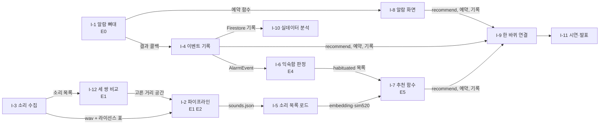

# 아빠 안잔다 — 이슈 초안

> 아직 등록하지 않았다. 팀 검토 뒤 등록한다(등록 직전에 열린 이슈를 다시 조회해 중복을 막는다). 이슈 본문에서 설계 내용은 [design.md](design.md), 모양·함수·저장 위치는 [contracts.md](contracts.md) 절 링크로 가리킨다. **이슈 하나가 계약 하나 이상을 구현하고, 계약과 다르게 만들 일이 생기면 계약 변경 PR부터 올린다**(contracts.md 9절).

## 완성의 범위

v1 = [design.md 1.1](design.md#11-범위)의 "반드시" 전부 + 6절 실험 E0·E1·E2·E4·E5.
뺀 것: 사용자 음원 추가, 휴식 후 복귀, iOS, E3(라벨이 모자라면).

## 담당 제안 (회의에서 확정)

| 사람 | 영역 | 이슈 | 지금 시작 가능 |
|---|---|---|---|
| A | 앱: 알람·기록 | I-1, I-4, I-8, I-9 | I-1 |
| B | 앱: 추천 | I-5, I-6, I-7 | I-6, I-7 (계약 예시 데이터로) |
| C | AI: 소리·파이프라인 | I-2, I-3, I-10, I-12 | I-2, I-3 |
| 누구든 | 설정 | I-0 | I-0 |
| 전원 | 세 쌍 비교 응답, 마무리 | I-12(응답), I-11 | — |

## 의존성 그래프

화살표 = "먼저 있어야 함", 라벨 = 넘겨주는 것.

I-2·I-3은 동시에 시작한다: 파이프라인은 대조 소리 5개(합성 + 아무 무료 음원)로 먼저 만들고, 수집된 소리가 오면 다시 돌린다. I-6·I-7은 [contracts.md 8절 가짜 데이터](contracts.md#8-가짜-데이터-먼저-시작하는-사람용)로 먼저 만든다. A의 화면(I-8)도 같은 가짜 데이터로 먼저 시작할 수 있다.

## 마일스톤

| 마일스톤 | 기한 | 이슈 |
|---|---|---|
| M1 뼈대 | 11/16 | I-0, I-1, I-2, I-3 |
| M2 추천 한 바퀴 | 11/19 | I-4, I-5, I-6, I-7, I-8, I-9, I-12 |
| M3 실험 반영 | 11/20 | I-10, (E4·E5 반영 PR) |
| M4 제출 | 11/21 | I-11 |

라벨: `area:app-alarm` `area:app-recommend` `area:ai` `experiment` `chore`

---

## I-0 레포 설정과 평가표 확인 `chore`

### 이 이슈는
README와 실제 설정이 다른 곳을 맞추고, 평가 기준 원문을 확인한다. 평가표 없이 범위를 잡으면 심사에서 보는 것을 놓친다.
- 먼저 필요: 없음(지금 시작 가능)
- 이게 끝나면: 범위 조정이 필요하면 design.md 1.1 수정

### 할 일
- [ ] GitHub 기본 브랜치를 `develop`으로 변경(지금은 `main`)
- [ ] 공모전 평가표 원문을 읽고 [design.md 0절](design.md#0-틀) 평가 기준 칸 채우기
- [ ] `app.json`의 `name`·`slug`·`scheme`을 템플릿 값 `app`에서 프로젝트 이름으로
- [ ] README의 "React Native Reusables 우선 사용"을 실제 설치 여부에 맞게 정리

### 완료 조건
- [ ] 새 PR을 열면 대상이 기본으로 `develop`

## I-1 알람 뼈대: 지정한 소리로 울리고 결과 받기 `area:app-alarm` `experiment`

### 이 이슈는
설계 전체가 기대는 가정 R1을 확인한다(실험 E0). 공식 문서상 직접 넣은 소리는 Expo Go에서 안 되므로([design.md 1.6 R1](design.md#16-가정위험)) **개발 빌드로 시작한다.** 남은 질문은 어느 알람 라이브러리로 끌 때까지 울리게 하나다. 기능은 최소: 버튼 하나로 "2분 뒤, 소리 X로 알람".
- 먼저 필요: 없음(지금 시작 가능)
- 이게 끝나면: I-4, I-8

### 할 일
- [ ] EAS 개발 빌드 만들기(`app/android`를 만들지 않음)와 팀원 설치 방법을 README에 적기
- [ ] 알람 라이브러리 후보(예: notifee)의 SDK 58 호환·반복 재생·전체 화면 표시·Android 14 권한 확인(`app/AGENTS.md` 규칙: 기억 말고 문서)
- [ ] 소리 2개를 번들하고, 예약할 때 소리를 고를 수 있게(소리마다 채널)
- [ ] 끄기·스누즈 버튼 결과를 앱이 받는 경로, 무응답 판정 방법([design.md 2.4](design.md#24-시퀀스-알람-한-번)의 `?`)
- [ ] 앱이 꺼진 상태 포함 10회 측정 → [6절 E0](design.md#6-구현하면서-하는-실험) 결과 기록

### 완료 조건
- [ ] 실기기 측정 표(맞는 소리 비율, 지연, 무음 모드)와 결론 한 단락: 고른 라이브러리와 이유
- [ ] 소리 파일 형식·위치를 정해 [contracts.md 10절](contracts.md#10-아직-열린-곳)과 C3 수정 PR

## I-2 오프라인 파이프라인: sounds.json 만들기 `area:ai` `experiment`

### 이 이슈는
소리마다 YAMNet 임베딩과 520 유사도를 미리 계산해 앱에 넘긴다(AD1). 실험 E1·E2를 여기서 한다.
- 먼저 필요: 없음(대조 소리로 시작 가능). I-3이 끝나면 다시 실행
- 이게 끝나면: I-5

### 할 일
- [ ] YAMNet 불러오기(TF Hub 또는 공개 가중치)와 실제 출력 모양 확인: 조각 수 × 1024, × 521 ([2.3](design.md#23-데이터-흐름도))
- [ ] 520 Hz 사각파 3초 합성(16 kHz)
- [ ] `sim520` 세 방식 A·B·C 계산([4.3](design.md#43-520-유사도-후보-e2에서-하나-고름))
- [ ] 거리 공간 후보 세 벡터 계산: YAMNet 임베딩, 로그 멜 평균(64칸), 손 특징. I-12 결과로 고른 것을 `embedding`에, 이름을 `model.space`에([AD7](design.md#3-아키텍처-결정-권장))
- [ ] `sounds.json`·소리 파일·`sound-assets.ts` 출력([C2](contracts.md#c2-soundsjson-파이프라인--앱)·[C3](contracts.md#c3-소리-파일과-자산-목록-파이프라인--앱)) + C2 규칙 assert
- [ ] E1: 고른 공간의 쌍별 코사인 분포(`simNormalize` 결정) / E2: 대조 소리 5개 순위 표
- [ ] `requirements.txt`에 YAMNet 실행 의존성 추가(현재 torch만 있음, YAMNet 공식 구현은 TensorFlow)

### 완료 조건
- [ ] 코사인 분포·순위 표 이미지가 PR에 있고, E1(분포)·E2 결론 한 단락씩

## I-3 소리 목록 수집 `area:ai`

### 이 이슈는
추천 후보가 될 알람 음원 30~50개를 라이선스와 함께 모은다(D6, R6). 후보가 적으면 추천이 의미 없다.
- 먼저 필요: 없음(지금 시작 가능)
- 이게 끝나면: I-2 재실행

### 할 일
- [ ] 출처·라이선스·계열(`group`) 표 작성. 계열은 벨·멜로디·경보·자연음·음성 등 4~6종, 계열마다 5개 이상(E1에 필요)
- [ ] 앱 번들용 mp3 변환(iOS 알림이면 30초 이하 — I-1 결과 따라)
- [ ] 원본은 `ai/data/`(git 제외), 공유는 팀 드라이브

### 완료 조건
- [ ] 라이선스 표에 빈 칸 없음

## I-4 이벤트 기록 `area:app-alarm`

### 이 이슈는
알람마다 결과를 기기에 저장하고 Firestore에 올린다(D3, AD6). 익숙함 판정과 실데이터 분석의 재료다.
- 먼저 필요: I-1(결과 콜백). 계약은 정해져 있으니 저장 부분은 먼저 시작 가능
- 이게 끝나면: I-6, I-9, I-10

### 할 일
- [ ] Firebase 익명 인증
- [ ] 이벤트 저장소([C7](contracts.md#c7-이벤트-저장소-a-제공-bc10이-사용))와 Firestore 업로드([C11](contracts.md#c11-firestore))
- [ ] 결과 판정([C6](contracts.md#c6-결과-판정-규칙-a가-c5-안에서-적용))
- [ ] Firestore 보안 규칙: 자기 `uid` 경로만 읽고 쓰기

### 완료 조건
- [ ] 알람 3회 뒤 Firestore 콘솔 화면에 이벤트 3개

## I-5 소리 목록 로드 `area:app-recommend`

### 이 이슈는
`sounds.json`과 소리 파일을 앱에 넣고 타입을 정한다.
- 먼저 필요: I-2(진짜 파일). 계약 예시로 먼저 시작 가능
- 이게 끝나면: I-7

### 할 일
- [ ] `Sound` 타입과 로더, 앱 시작 시 한 번 읽기
- [ ] 소리 파일 번들 방식은 I-1 결과에 맞춤

### 완료 조건
- [ ] 소리 목록 화면(제목·계열·sim520)이 뜬다

## I-6 습관화 강도와 설정 파일 `area:app-recommend` `experiment`

### 이 이슈는
이벤트에서 소리마다 습관화 강도 `H`를 계산한다. 비슷한 소리에서 받은 나쁜 신호는 비슷한 만큼 번지고, 오래된 신호는 `tauDays`에 따라 줄어든다([design.md 4.2](design.md#42-점수)). 실험값은 설정 파일 한 곳에(AD5). E4.
- 먼저 필요: 없음(가짜 이벤트로 시작 가능). 실데이터 확인은 I-4 뒤
- 이게 끝나면: I-7

### 할 일
- [ ] `app/src/config.ts`([C9](contracts.md#c9-설정-실험으로-바뀌는-값))
- [ ] `computeStats(library, events, config, now)`(순수 함수) + 단위 테스트: [contracts.md 8절](contracts.md#8-가짜-데이터-먼저-시작하는-사람용)의 일반화(`beep_3k` 0.5219)·회복 사례, `now`보다 뒤 이벤트 무시
- [ ] 소리별 통계는 저장하지 않고 이벤트에서 매번 계산(`computeStats`, [C8](contracts.md#c8-추천-모듈-b-제공-c10화면이-사용) 순수 함수)

### 완료 조건
- [ ] 테스트 통과 출력, E4는 I-10에서 실데이터로

## I-7 추천 함수 `area:app-recommend` `experiment`

### 이 이슈는
[4.2 점수](design.md#42-점수)를 순수 함수 `recommend({ library, events, config })`로([C8](contracts.md#c8-추천-모듈-b-제공-c10화면이-사용)). E5.
- 먼저 필요: 없음(손으로 만든 임베딩으로 시작 가능)
- 이게 끝나면: I-9

### 할 일
- [ ] `pHabit`(I-6의 `computeStats` 결과 사용), 최근 제외, 가중합, argmax, 폴백. 반환은 C4 `Recommendation`(`soundId`·`score`·`novelty`·`pHabit`·`sim520`·`fallback`·`configVersion`)
- [ ] 단위 테스트: [contracts.md 8절](contracts.md#8-가짜-데이터-먼저-시작하는-사람용) 기대 결과 전부, Q4(최근 3개 제외)
- [ ] 50개 기준 계산 시간 측정(Q2)
- [ ] E5: `w` 0~1 민감도 표

### 완료 조건
- [ ] 테스트 출력 + 민감도 표

## I-8 알람 화면 `area:app-alarm`

### 이 이슈는
Expo 템플릿 화면을 실제 화면으로 바꾼다: 알람 목록·추가·켜고 끄기, 다음 소리와 그 이유.
- 먼저 필요: I-1(예약 함수)
- 이게 끝나면: I-9

### 할 일
- [x] 템플릿 화면·컴포넌트 정리 (2026-11-16 `fix/remove-example-code`에서 직접 삭제, `reset-project` 스크립트도 삭제)
- [ ] 목록·추가(시각 선택)·삭제, 기존 `useAlarmStore` 사용
- [ ] 알람 카드에 "다음 소리: 탁상 벨 (낯섦 0.8 · 520 유사 0.6)"
- [ ] 끈 직후 "이 소리, 익숙했나요?" 예·아니오·건너뛰기 → `recordSelfReport`([C10](contracts.md#c10-연결-순서-a-제공)·[C12](contracts.md#c12-화면이-읽는-상태-a-화면--b-추천)). `timeout`이면 묻지 않음

### 완료 조건
- [ ] 실행 화면 캡처

## I-9 한 바퀴 연결 `area:app-alarm`

### 이 이슈는
결과 → 판정 → 추천 → 재예약을 이어 [사용자 흐름](design.md#21-사용자-흐름) 3~6이 끝까지 돈다(Q5).
- 먼저 필요: I-4, I-7, I-8
- 이게 끝나면: I-11

### 할 일
- [ ] 결과 수신 시 통계 갱신 → `recommend()` → 다음 예약 교체
- [ ] 추천 당시 값을 `AlarmEvent.pick`(C4 `PickSnapshot`)에 저장([C10](contracts.md#c10-연결-순서-a-제공) 1단계)

### 완료 조건
- [ ] 같은 날 같은 소리로 스누즈 2번 → 비슷한 소리들의 `pHabit`이 함께 오르고 다음 알람 소리가 다른 계열로 바뀌는 녹화

## I-10 실데이터 분석 `area:ai` `experiment`

### 이 이슈는
팀 실사용 이벤트를 내려받아 E4(나쁜 신호가 자기 보고와 맞나, `tauDays`·`habituatedAt`)를 판단하고, 자기 보고 라벨이 충분하면 E3을 한다.
- 먼저 필요: I-4
- 이게 끝나면: 설정값 변경 PR

### 할 일
- [ ] Firestore 내보내기 스크립트 → `ai/notebooks/`
- [ ] 결과(`outcome`)별 "익숙했다" 비율: `snoozed`·`timeout`이 `dismissed`보다 높은가 → `badSignalWeight` 조정 근거
- [ ] 소리별 `pHabit` 추이
- [ ] (자기 보고 "익숙했다"·"아니다" 각 5개 이상이면) E3

### 완료 조건
- [ ] 결과 한 단락과 바꾼 설정값. 결론은 "동작 확인"까지만, 효과 주장 금지([design.md 1.5](design.md#15-품질-목표))

## I-11 시연·발표

- 먼저 필요: I-9
- [ ] 시연 시나리오(같은 날 스누즈 2번 → 비슷한 소리까지 익숙함 상승 → 다른 계열로 교체 → 이유 화면)와 녹화
- [ ] 품질 목표 대 실측 표(Q1~Q5), 한계(효과 미검증, 문헌 근거 강도, 세 쌍 비교 3명, 습관화 성질의 알람 적용은 직접 근거 없음, 익명 계정)
- [ ] 근거 논문 원문 확인([design.md 7절](design.md#7-근거-자료-요약))

## I-12 세 쌍 비교로 거리 공간 고르기 `area:ai` `experiment`

### 이 이슈는
"소리 간 거리"를 YAMNet이라서 믿지 않고, 사람 판단과 가장 잘 맞는 공간을 데이터로 고른다(E1, [AD7](design.md#3-아키텍처-결정-권장)). 발표에서 "AI 활용의 타당성" 근거가 된다.
- 먼저 필요: I-3(소리 목록 일부). I-2의 후보 벡터 세 개
- 이게 끝나면: I-2 재실행(`model.space` 확정)

### 할 일
- [ ] 30문항 만들기([contracts.md C1](contracts.md#c1-소리-원본-입력-수집--파이프라인-c-내부) 형식). 같은 계열 안 문항과 다른 계열 문항을 섞는다
- [ ] 팀 3명이 같은 문항에 답한다(한 사람 15분, 서로 답을 보지 않는다)
- [ ] 후보 셋의 일치율을 **같은 문항·같은 응답**으로 계산. 기준선 50%, 상한은 사람끼리 일치율
- [ ] 같은 계열 안 문항만 따로 본 일치율(YAMNet이 계열 구분만 잘하는지 확인)

### 완료 조건
- [ ] 일치율 표와 결론 한 단락: 고른 공간과 이유. 셋 다 우연 수준이면 [design.md R2](design.md#16-가정위험)의 대안 적용
