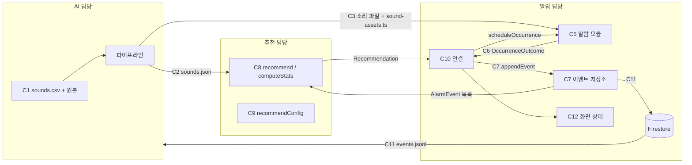

# 계약 (Contracts)

> 3명이 각자 구현해도 이음새가 맞도록, 사람과 사람 사이를 오가는 **모든 데이터·함수·파일·저장 위치**의 모양과 규칙을 정한다.
> **계약이 코드보다 먼저다.** 계약과 다른 코드가 필요하면 코드를 고치기 전에 이 문서를 고치는 PR부터 올린다(9절).
> 설계 배경(왜 이렇게 나눴나)은 [design.md](design.md), 실험으로 바뀔 값의 근거는 [design.md 6절](design.md#6-구현하면서-하는-실험).

## 0. 경계 지도

| 담당 (제안) | 영역 | 제공하는 계약 | 쓰는 계약 |
|---|---|---|---|
| **A** 앱: 알람·기록 | 예약·울림·결과 판정, 이벤트 저장, Firestore, 화면, 연결 | C5 알람 모듈, C6 결과 판정, C7 이벤트 저장소, C10 연결 순서, C11 Firestore, C12 화면 상태 | C2, C3, C8, C9 |
| **B** 앱: 추천 | 소리 목록 로드, 통계·익숙함 판정, 추천 | C2 로더 검사, C8 추천 모듈, C9 추천 설정 | C4, C7 |
| **C** AI | 소리 수집, 파이프라인, 실데이터 분석 | C1 원본 입력, C2 sounds.json, C3 소리 파일·자산 목록 | C11 내보내기 |
| 공통 | — | C4 공유 타입, 1절 공통 규칙 | — |



## 1. 공통 규칙

| 항목 | 규칙 | 예 |
|---|---|---|
| 소리 ID | `^[a-z][a-z0-9_]{0,31}$`. 소문자·숫자·밑줄만. 한 번 쓴 ID는 다른 소리에 다시 쓰지 않는다. **하이픈 금지**(Android 리소스 이름에 쓸 수 없음) | `bell_01` |
| 알람 ID | `a_` + 8자리 소문자·숫자 | `a_k3f9x0qz` |
| 시각 | ISO 8601, **초까지, 기기 현지 오프셋 포함**. 문자열로 저장 | `2026-11-16T07:00:00+09:00` |
| 알람 시각(반복) | `HH:mm` 24시간 | `07:00` |
| 시간 길이 | **초**(정수 또는 소수). 이름 끝에 `Sec`. 설정값만 예외로 이름에 단위를 붙인다(`snoozeMin`) | `responseSec: 142` |
| 0~1 점수 | 소수 4자리로 반올림해 저장, 계산 중에는 반올림하지 않는다 | `0.4137` |
| 이벤트 ID | `${alarmId}__${occurrenceAt}` (밑줄 2개) | `a_k3f9x0qz__2026-11-16T07:00:00+09:00` |
| 이름 | 코드 식별자는 영어 camelCase, 화면 문구·주석은 한국어 | — |
| v1 알람 반복 | **매일 반복**만. 요일 선택은 "되면 좋음" | — |

## C1. 소리 원본 입력 (수집 → 파이프라인, C 내부)

- 위치: `ai/data/sounds/` 원본 파일, `ai/data/sounds.csv` 목록. 둘 다 **git 제외**(팀 드라이브 공유)
- `sounds.csv` 열 (UTF-8, 머리줄 있음)

| 열 | 형식 | 규칙 |
|---|---|---|
| `id` | 소리 ID | 1절 규칙 |
| `file` | 문자열 | `ai/data/sounds/` 기준 상대 경로. wav·mp3·ogg·flac |
| `title` | 문자열 | 화면에 보일 한국어 이름, 20자 이내 |
| `group` | `bell`·`melody`·`beep`·`nature`·`voice`·`other` | 사람이 듣고 붙인다. 계열마다 5개 이상(E1) |
| `license` | 문자열 | `CC0`, `CC-BY-4.0`, `자체 제작` 등. 빈 칸이면 파이프라인이 거부 |
| `source_url` | 문자열 | 자체 제작이면 `-` |

## C2. `sounds.json` (파이프라인 → 앱)

- 위치: `app/src/data/sounds.json` (**커밋함**, 파이프라인 출력이며 사람이 손으로 고치지 않는다)
- 만드는 명령: `cd ai && python -m src.build_sounds --csv data/sounds.csv --app ../app`
- 타입은 C4의 `SoundLibrary`. 필드별 규칙:

| 필드 | 규칙 |
|---|---|
| `schemaVersion` | `1`. 아래 규칙이 깨지는 변경이면 올린다(9절) |
| `generatedAt` | 생성 시각(1절 시각 규칙) |
| `model.name` | `"yamnet"` |
| `model.embeddingDim` | `1024` (가짜 데이터는 `4`). 모든 `embedding` 길이와 같아야 함 |
| `sounds` | 1개 이상. `id` 중복 없음. `id` 오름차순 정렬 |
| `sounds[].embedding` | 길이 `embeddingDim`, **L2 노름 1 ± 1e-3**, 소수 5자리 |
| `sounds[].sim520.emb·mel·hand` | 각각 0~1. 세 방식 모두 항상 채운다(어느 것을 쓸지는 C9 `sim520Method`) |
| `sounds[].durationSec` | 0보다 큼. 알림 소리 길이 제한은 R1 결과로 정한다(10절) |
| `sounds[].top3` | YAMNet 상위 3개 클래스 이름(영어 원문). 설명·검증용, 점수에 안 씀 |
| `sounds[].file` | C3의 파일 이름과 같음 |

**검사 책임:** 파이프라인이 쓰기 전에 위 규칙을 assert(C). 앱 로더 `loadSoundLibrary()`가 읽을 때 같은 규칙을 다시 검사하고, 어기면 어느 규칙을 어긴 어느 `id`인지 적은 `Error`를 던진다(B). 둘이 서로 다른 규칙을 검사하면 안 되므로 규칙은 이 표 하나다.

## C3. 소리 파일과 자산 목록 (파이프라인 → 앱)

| 산출물 | 위치 | 규칙 |
|---|---|---|
| 소리 파일 | `app/assets/sounds/<id>.<ext>` | 파이프라인이 변환해 복사. 형식(mp3·wav·caf)과 최대 길이는 **R1 결과로 확정**(10절). 확정 전 기본: mp3, 모노, 44.1 kHz, 30초 이하. 전체 10 MB 이하 |
| 자산 목록 | `app/src/data/sound-assets.ts` | 파이프라인이 생성. `export const soundAssets: Record<SoundId, number> = { bell_01: require('../../assets/sounds/bell_01.mp3'), ... }`. RN은 `require` 경로가 정적이어야 해서 손으로 쓰지 않고 생성한다 |

`sounds.json`의 모든 `id`가 `soundAssets`에 있어야 한다(로더가 검사).

## C4. 공유 타입

- 위치: `app/src/types/contracts.ts`. **이 문서의 코드 블록을 그대로 옮긴다.** 다른 파일에서 같은 모양의 타입을 새로 만들지 않고 여기서 import한다
- 기존 `app/src/stores/alarm-store.ts`의 `Alarm` 타입은 이 파일로 옮긴다

```ts
export type SoundId = string; // 1절 규칙
export type AlarmId = string; // 1절 규칙
export type IsoTime = string; // 1절 규칙
export type SoundGroup = 'bell' | 'melody' | 'beep' | 'nature' | 'voice' | 'other';
export type Sim520Method = 'emb' | 'mel' | 'hand';

export interface Sound {
  id: SoundId;
  file: string;
  title: string;
  group: SoundGroup;
  license: string;
  sourceUrl: string;
  durationSec: number;
  embedding: number[];
  sim520: Record<Sim520Method, number>;
  top3: string[];
}

export interface SoundLibrary {
  schemaVersion: 1;
  generatedAt: IsoTime;
  model: { name: 'yamnet'; embeddingDim: number };
  sounds: Sound[];
}

export interface Alarm {
  id: AlarmId;
  time: string; // 'HH:mm', 매일 반복
  enabled: boolean;
  soundId?: SoundId; // 다음에 울릴 소리. C10 연결만 쓴다
}

export type Outcome = 'dismissed' | 'dismissed_late' | 'snoozed' | 'timeout';

/** 알람 한 번(occurrence)의 결과. C5가 만든다 */
export interface OccurrenceOutcome {
  alarmId: AlarmId;
  soundId: SoundId;
  occurrenceAt: IsoTime; // 예약된 시각(스누즈로 다시 울려도 처음 값 유지)
  endedAt: IsoTime; // 결과가 정해진 시각
  outcome: Outcome;
  responseSec: number | null; // occurrenceAt → 끄기. timeout이면 null
  snoozeCount: number;
  backfilled: boolean; // 앱이 꺼져 있어 나중에 소급 판정했나
}

/** 추천 당시 값. 나중에 분석용 */
export interface PickSnapshot {
  score: number;
  novelty: number;
  pHabit: number;
  sim520: number;
  w: number;
  sim520Method: Sim520Method;
  configVersion: number;
}

/** 저장되는 이벤트 = 결과 + 추천 당시 값 */
export interface AlarmEvent extends OccurrenceOutcome {
  schemaVersion: 1;
  eventId: string; // 1절 규칙
  pick: PickSnapshot | null; // 추천 없이 정한 소리(첫 알람 직후 등)면 null
  appVersion: string; // app.json version
}

export interface SoundStat {
  soundId: SoundId;
  plays: number; // 이 소리의 이벤트 수
  recentBad: number; // 최근 W개 이벤트의 나쁜 신호 합
  habituated: boolean;
  lastPlayedAt: IsoTime | null;
}

export type RecommendFallback = 'none' | 'recent_relaxed' | 'all_habituated';

export interface Recommendation {
  soundId: SoundId;
  score: number;
  novelty: number;
  pHabit: number;
  sim520: number; // 정규화 뒤 값
  fallback: RecommendFallback;
  configVersion: number;
}
```

## C5. 알람 모듈 (A 제공, C10이 사용)

- 위치: `app/src/lib/alarm.ts`. 내부 구현(expo-notifications인지 네이티브 모듈인지)은 R1 결과로 바뀌어도 **아래 함수 모양은 바꾸지 않는다**

```ts
/** 다음 울릴 시각. 순수 함수. now가 정확히 그 시각이면 내일 */
export function nextOccurrence(time: string, now: IsoTime): IsoTime;

/** 이 알람의 기존 예약을 지우고 at에 soundId로 새로 예약 */
export function scheduleOccurrence(alarm: Alarm, soundId: SoundId, at: IsoTime): Promise<void>;

export function cancelAlarm(alarmId: AlarmId): Promise<void>;

/** 결과가 정해질 때마다 한 번 호출. 반환값은 구독 해제 함수 */
export function onOutcome(listener: (o: OccurrenceOutcome) => void): () => void;

/** 앱 시작 시 호출. 앱이 꺼져 있는 사이 기한이 지난 예약을 timeout으로 소급 판정 */
export function reconcile(now: IsoTime): Promise<OccurrenceOutcome[]>;

export class AlarmError extends Error {
  code: 'permission_denied' | 'sound_missing' | 'schedule_failed';
}
```

- `scheduleOccurrence` 실패는 `AlarmError`로 던진다. `soundAssets`에 없는 `soundId`면 `sound_missing`
- 같은 occurrence에 대해 `onOutcome`은 **정확히 한 번**. `reconcile`이 돌려준 것과 `onOutcome`으로 보낸 것이 겹치면 안 된다

## C6. 결과 판정 규칙 (A가 C5 안에서 적용)

기준 시각 t0 = `occurrenceAt`. 설정값은 C9 `alarmConfig`.

| 순서 | 상황 | `outcome` | `responseSec` |
|---|---|---|---|
| 1 | 스누즈 없이 끄기, t − t0 ≤ `okSec` | `dismissed` | t − t0 |
| 2 | 스누즈 없이 끄기, t − t0 > `okSec` | `dismissed_late` | t − t0 |
| 3 | 스누즈를 1번 이상 누른 뒤 끄기 | `snoozed` | t − t0 |
| 4 | 마지막 울림 + `maxSec` 동안 끄기 없음 | `timeout` | `null` |
| 5 | 앱이 꺼져 있어 4를 그때 못 봄 → 다음 실행의 `reconcile` | `timeout`, `backfilled: true` | `null` |

- 마지막 울림 = t0 + `snoozeCount × snoozeMin × 60`
- 알림을 옆으로 밀어 지운 것을 앱이 알 수 있으면 "끄기"로 본다. 알 수 없으면 5로 처리된다(R1에서 확인)
- 알람이 울리기 전에 끄거나(enabled false) 지우거나 시각을 바꾸면 그 occurrence는 **이벤트를 만들지 않는다**
- 나쁜 신호 점수(C9 `badSignalWeight`)는 B가 통계에서 붙인다. A는 `outcome`만 정한다

## C7. 이벤트 저장소 (A 제공, B·C10이 사용)

- 위치: `app/src/stores/event-store.ts` (Zustand + persist)

```ts
/** 같은 eventId면 덮어쓴다(멱등). 로컬 저장은 동기, Firestore 업로드는 syncPending이 따로 */
export function appendEvent(e: AlarmEvent): void;

/** occurrenceAt 오름차순. 반환 배열을 고치지 않는다 */
export function getEvents(): readonly AlarmEvent[];

/** 아직 안 올린 이벤트를 Firestore에 올린다. 실패해도 던지지 않는다 */
export function syncPending(): Promise<{ synced: number; failed: number }>;
```

- 로컬 저장소 키: `appa.events.v1`. 업로드 여부는 저장소 안 `syncedIds`로만 관리하고 `AlarmEvent`에 넣지 않는다
- 로컬 저장 기술: Zustand `persist` + `@react-native-async-storage/async-storage` [권장]. A가 뼈대 단계에서 `npx expo install`로 추가

## C8. 추천 모듈 (B 제공, C10·화면이 사용)

- 위치: `app/src/lib/recommend.ts`, `app/src/lib/sound-library.ts`. **모두 순수 함수**(시간·저장소·네트워크에 접근하지 않음)

```ts
/** sounds.json + soundAssets를 읽고 C2·C3 규칙 검사. 어기면 Error */
export function loadSoundLibrary(): SoundLibrary;

/** 소리별 통계. 이벤트가 없는 소리도 plays 0으로 포함 */
export function computeStats(
  library: SoundLibrary,
  events: readonly AlarmEvent[],
  config: RecommendConfig,
): Record<SoundId, SoundStat>;

export function recommend(input: {
  library: SoundLibrary;
  events: readonly AlarmEvent[];
  config: RecommendConfig;
}): Recommendation;
```

**동작 규칙** (수식은 [design.md 4.2](design.md#42-점수))

1. 익숙해짐: 그 소리의 이벤트를 `occurrenceAt` 내림차순으로 최근 `window`개 → `badSignalWeight` 합 ≥ `threshold`
2. 최근 제외: 전체 이벤트를 `occurrenceAt` 내림차순으로 보며 서로 다른 `soundId` 앞쪽 `recentExclude`개
3. `sim520`: `sim520Method` 값을 **소리 목록 전체** 기준 최소-최대 정규화. 최댓값 = 최솟값이면 모두 0.5
4. `pHabit`: 익숙해진 소리와의 최대 코사인, 0 미만은 0. 익숙해진 소리가 없으면 0. `pHabitNormalize`가 참이면 소리 목록 안 쌍별 코사인의 최소-최대로 정규화
5. 후보가 비면: 최근 제외를 풀고 `fallback: 'recent_relaxed'`. `excludeHabituated`로 비면 익숙해진 소리를 다시 넣고 `'all_habituated'`
6. 점수가 같으면 `soundId` 오름차순으로 앞선 것
7. **결정적**: 같은 입력이면 항상 같은 출력
8. 성능: 소리 50개 × 1024차원, 이벤트 500개에서 200 ms 이내(Q2)

## C9. 설정 (실험으로 바뀌는 값)

- 위치: `app/src/config.ts`. 값을 바꾸는 PR에는 근거 실험 결과 한 단락을 붙이고 `configVersion`을 1 올린다

```ts
export const alarmConfig = {
  okSec: 60, // E4
  maxSec: 300, // E4
  snoozeMin: 5,
} as const;

export interface RecommendConfig {
  configVersion: number;
  window: number; // W
  threshold: number; // K
  badSignalWeight: Record<Outcome, number>;
  w: number; // 0~1, 낯섦 가중치
  recentExclude: number;
  excludeHabituated: boolean;
  sim520Method: Sim520Method;
  pHabitNormalize: boolean;
}

export const recommendConfig: RecommendConfig = {
  configVersion: 1,
  window: 5, // E4
  threshold: 2, // E4
  badSignalWeight: { dismissed: 0, dismissed_late: 0.5, snoozed: 1, timeout: 1 },
  w: 0.5, // E5
  recentExclude: 3,
  excludeHabituated: false,
  sim520Method: 'emb', // E2
  pHabitNormalize: false, // E1
};
```

| 값 | 허용 범위 | 바꾸는 실험 |
|---|---|---|
| `okSec` | 10~300 | E4 |
| `maxSec` | 60~900 | E4 |
| `window` | 1~20 | E4 |
| `threshold` | 0 초과, `window` 이하 | E4 |
| `w` | 0~1 | E5 |
| `recentExclude` | 0 이상, 소리 수 미만 | — |
| `sim520Method` | `emb`·`mel`·`hand` | E2 |
| `pHabitNormalize` | 참·거짓 | E1 |

## C10. 연결 순서 (A 제공)

- 위치: `app/src/lib/orchestrator.ts`. 화면과 앱 시작 코드는 이 함수들만 부른다

```ts
/** 결과 하나 처리: 저장 → 업로드 시도 → 다음 소리 추천 → 재예약 */
export function handleOutcome(o: OccurrenceOutcome): Promise<void>;

/** 알람 추가·켜기·시각 변경 시: 추천 → 예약 */
export function armAlarm(alarm: Alarm): Promise<void>;

/** 앱 시작 시: reconcile → handleOutcome 반복 → syncPending */
export function onAppStart(): Promise<void>;
```

`handleOutcome` 순서와 실패 시 동작:

| 단계 | 할 일 | 실패하면 |
|---|---|---|
| 1 | 그 알람의 대기 중 추천(`pending[alarmId]`)을 꺼내 `pick`으로 | 없으면 `pick: null` |
| 2 | `AlarmEvent` 조립(`eventId`·`appVersion`·`schemaVersion`) 후 `appendEvent` | — (동기, 실패 없음) |
| 3 | `syncPending()`을 기다리지 않고 시작 | 무시. 다음 실행 때 다시 |
| 4 | `recommend({ library, events: getEvents(), config })` | 직전 `soundId` 유지, 오류 기록 |
| 5 | `scheduleOccurrence(alarm, soundId, nextOccurrence(alarm.time, now))` | 화면에 오류 띠. 알람은 `enabled` 유지 |
| 6 | `pending[alarmId] = 추천 결과`, `alarm.soundId = soundId` | — |

- 대기 중 추천 저장소 키: `appa.pending.v1`. 알람 저장소 키: `appa.alarms.v1`
- 꺼진 알람(`enabled: false`)은 4~6을 하지 않는다

## C11. Firestore

| 항목 | 내용 |
|---|---|
| 인증 | Firebase 익명 인증. 앱 첫 실행 때 한 번 |
| 경로 | `users/{uid}/events/{eventId}` |
| 문서 | `AlarmEvent` 필드 그대로 + `uploadedAt`(서버 타임스탬프). 시각 필드는 문자열 그대로 |
| 쓰기 | `setDoc`으로 덮어쓰기. `eventId`가 같으면 결과가 같다(멱등) |
| 읽기 | 앱은 Firestore를 읽지 않는다(추천은 로컬 이벤트로) |

보안 규칙 (`firestore.rules`, A가 콘솔에 반영하고 레포에도 둠):

```
rules_version = '2';
service cloud.firestore {
  match /databases/{database}/documents {
    match /users/{uid}/events/{eventId} {
      allow read, write: if request.auth != null && request.auth.uid == uid;
    }
  }
}
```

내보내기 (C 사용):

- `ai/src/export_events.py`가 Firebase Admin(서비스 계정 키, **커밋 금지**)으로 전체 사용자 이벤트를 읽어 `ai/data/events.jsonl`(git 제외)로 쓴다
- 한 줄 = `AlarmEvent` + `"uid"`. 키 이름·값은 위 문서와 같다

## C12. 화면이 읽는 상태 (A 화면 ↔ B 추천)

| 화면에 보일 것 | 어디서 |
|---|---|
| 알람 목록·시각·켜짐 | `useAlarmStore` → `Alarm` |
| 다음 소리 이름 | `alarm.soundId` → `loadSoundLibrary()`의 `title` |
| 추천 이유("낯섦 0.80 · 520 유사 0.60") | `pending[alarmId]`의 `Recommendation`(`novelty`·`sim520`) |
| 익숙해진 소리 표시 | `computeStats(...)`의 `habituated` |
| 오류 띠 | `AlarmError.code`별 한국어 문구(A가 정함) |

## 8. 가짜 데이터 (먼저 시작하는 사람용)

- `app/src/data/sounds.fixture.json`: 아래 4개(`embeddingDim: 4`). C 파이프라인이 끝나기 전 B·A가 쓴다
- 이 데이터에 대한 **기대 결과가 곧 C8 계약 테스트**다

| id | group | embedding | sim520.emb |
|---|---|---|---|
| `beep_3k` | beep | [0.6, 0.8, 0, 0] | 0.6 |
| `melody_a` | melody | [0, 0, 1, 0] | 0.0 |
| `nature_a` | nature | [0, 0, 0.6, 0.8] | 0.2 |
| `square_520` | beep | [1, 0, 0, 0] | 1.0 |

(`mel`·`hand`는 `emb`와 같은 값, `top3`는 `[]`, `durationSec` 3, `license` `"자체 제작"`)

이벤트: `square_520`이 서로 다른 날 두 번 `snoozed`, 가장 최근 이벤트도 `square_520`.

설정: `recommendConfig` 기본값에서 `recentExclude: 1`만 바꿈.

| 경우 | 기대 결과 | 확인하는 규칙 |
|---|---|---|
| 기본 (`w` 0.5) | `nature_a`, score 0.6, pHabit 0, sim520 0.2 | 익숙해짐(2 ≥ 2), 최근 제외, 가중합 |
| `w: 0` | `beep_3k` (sim520만) | 가중치 끝값 |
| `w: 1` | `melody_a` (`nature_a`와 낯섦 1로 동점 → ID 순) | 동점 규칙 |
| 이벤트 없음 | `square_520` (pHabit 모두 0, sim520 최대) | 첫 실행 |
| 소리 1개 목록 + 그 소리가 최근 | 그 소리, `fallback: 'recent_relaxed'` | 폴백 |

## 9. 계약을 바꾸는 절차

1. 이 문서를 고치는 PR을 **코드보다 먼저** 올린다. 제목 접두어 `docs(contract):`
2. 그 계약을 쓰는 사람(0절 표) 전원이 승인해야 머지
3. `sounds.json`·`AlarmEvent` 모양이 깨지는 변경(필드 삭제·이름·의미 변경)은 `schemaVersion`을 올리고, 읽는 쪽이 옛 버전을 어떻게 처리할지 PR에 적는다. 선택 필드 추가는 올리지 않는다
4. 설정값 변경은 계약 변경이 아니다(C9 규칙만 따름)

## 10. 아직 열린 곳

| 항목 | 무엇에 달렸나 | 정해지면 고칠 곳 |
|---|---|---|
| 소리 파일 형식·최대 길이·위치(채널 소리면 네이티브 리소스로 들어가야 할 수 있음) | R1 실기기 확인 | C3 |
| 알림을 밀어 지운 것을 알 수 있나 | R1 | C6 두 번째 줄 |
| 테스트 실행 도구(jest-expo 등) | B가 추천 모듈 이슈에서 제안 | 5절(design.md) |
| 익명 인증 상태를 기기에 유지하는 방법(Firebase 13의 RN 지원) [미확인] | A가 이벤트 기록 이슈에서 문서 확인 | C11 |
