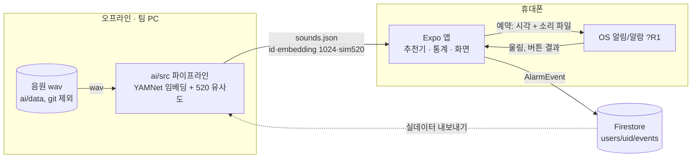
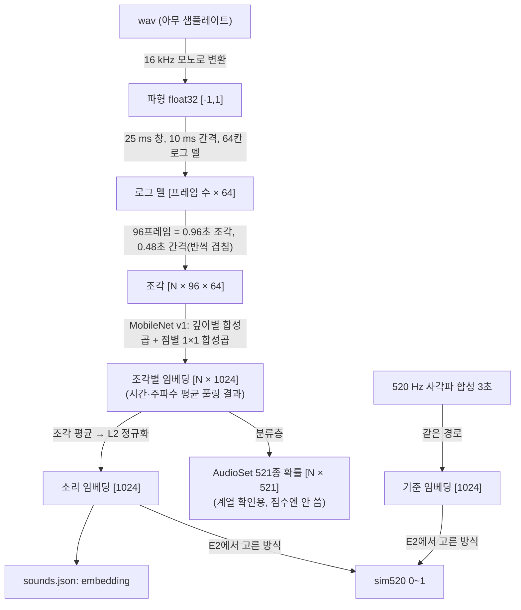
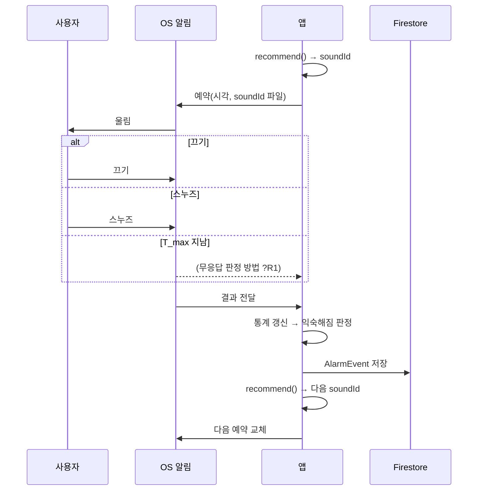
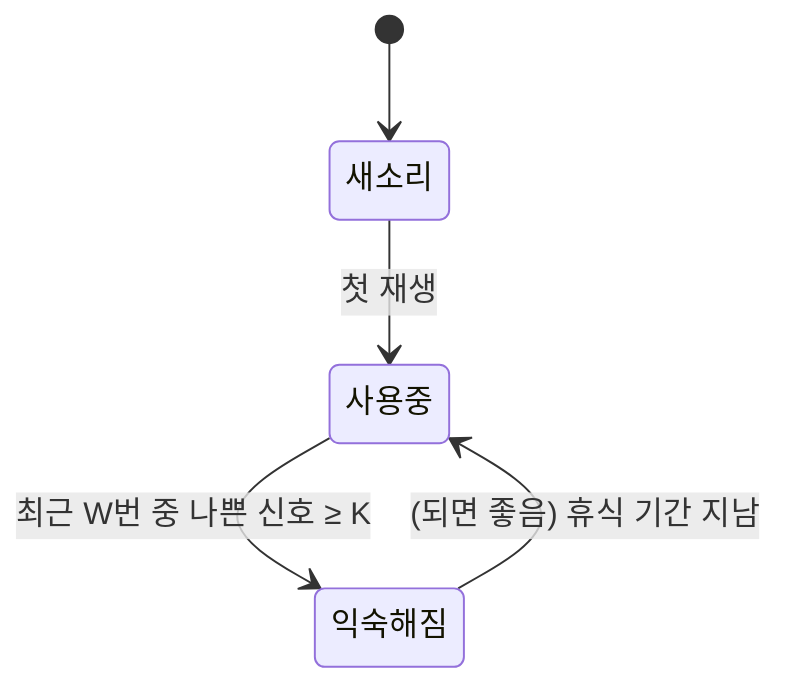

# 아빠 안잔다 — 설계 초안

> 근거: 팀 레포 README·CLAUDE.md(2026-11-13 커밋 기준), 팀원 설명(YAMNet 구조·사용 방법), 근거 자료 캡처(Bruck·Thomas, McFarlane 2020).
> 원칙: 마감이 8일이라 **실험을 설계 앞에 몰아 두지 않는다.** 결정마다 "실험 전 기본값"을 정해 바로 구현하고, 실험은 해당 이슈 안에서 돌려 기본값을 바꾼다(6절). 실험 전에 정하지 않으면 구조가 바뀌는 것(알람 울림 경로) 하나만 뼈대 이슈에서 먼저 확인한다.

## 0. 틀

| 항목 | 내용 |
|---|---|
| 평가 기준 | [미확인] 엘리스 AI챌린지 원문 평가표를 아직 안 봤다. **팀원 한 명이 원문을 읽고 이 칸을 채운다**(추측으로 채우지 않는다). "AI 활용의 타당성"과 "시연"이 있으면 1.5절 Q3·Q5의 비중을 올린다 |
| 이해관계자 | 쓰는 사람(아침에 못 일어나는 사용자), 만드는 사람(3명), 평가(공모전 심사), 외부 의존(Firebase, YAMNet 공개 모델, 음원 라이선스) |
| 작업 규칙 | 팀 레포 README에 있음: `main` 보호, `develop`에 PR, `feature/*`·`fix/*`, 커밋 접두어. **확인 필요:** 레포 실제 기본 브랜치가 `main`이다(README는 `develop`이라 함). PR 대상이 main으로 잡히기 쉬우니 Settings에서 기본 브랜치를 develop으로 바꾼다 |
| 완료의 정의 | `npx tsc --noEmit`·`npx expo lint` 통과, PR 리뷰 1명, 화면 변경은 실행 화면 첨부, 실험이 걸린 이슈는 실험 결과 한 단락(6절 형식) |

## 1. 요구사항

### 1.1 범위

| 반드시 | 되면 좋음 | 하지 않음 |
|---|---|---|
| 알람 예약·울림·끄기·스누즈 | 사용자가 자기 음원 추가(서버에서 임베딩 계산 필요) | YAMNet 파인튜닝(데이터·시간 부족, 6절 E3 참고) |
| 알람마다 행동 신호 기록 | 익숙해진 소리의 "휴식 후 복귀" | 수면 단계 측정(웨어러블·마이크) |
| 소리별 익숙함 판정(임계값) | 반복 요일·여러 알람 | 휴대폰 위에서 신경망 실행 |
| 소리 점수 = 낯섦 + 520 Hz 유사도, 가장 높은 소리 선택 | 추천 이유 화면("익숙함 0.2, 520 Hz 유사 0.8") | iOS 지원(시간 부족 시) |
| 번들 소리 목록 30~50개의 특징 사전 계산 | — | — |

### 1.2 사용자 스토리와 인수 조건

| ID | 스토리 | 인수 조건 (Given / When / Then) |
|---|---|---|
| US1 | 사용자로서 알람을 맞춰 정해진 시각에 깨고 싶다 | 7:00 알람이 있고 앱이 꺼져 있을 때 / 7:00이 되면 / 5초 안에 소리가 울린다 |
| US2 | 사용자로서 알람을 끄거나 미루고 싶다 | 알람이 울리는 중 / 끄기를 누르면 / 소리가 멈추고 `dismissed`가 기록된다. 스누즈를 누르면 `snoozed`, N분 뒤 다시 울린다 |
| US3 | (시스템) 사용자가 반응하지 않은 알람을 알고 싶다 | 알람이 울린 뒤 `T_max` 동안 아무 버튼도 안 눌림 / 시간이 지나면 / `timeout`이 기록된다 |
| US4 | 사용자로서 익숙해진 소리로 다시 깨우지 않기를 바란다 | 소리 A의 나쁜 신호가 임계값 이상 / 다음 알람 소리를 고를 때 / A와 임베딩이 가까운 소리일수록 점수가 낮다 |
| US5 | 사용자로서 깨우는 힘이 강한 소리로 깨고 싶다 | 낯섦이 같은 두 소리 / 고를 때 / 520 Hz 사각파 유사도가 높은 쪽이 선택된다 |
| US6 | 사용자로서 같은 소리가 연달아 나오지 않기를 바란다 | 최근 3번 울린 소리 / 다음 소리를 고를 때 / 그 3개는 후보에서 빠진다 |

### 1.3 용어집

| 용어 | 뜻 | 코드 이름 |
|---|---|---|
| 나쁜 신호 | 한 번의 알람에서 스누즈를 눌렀거나 `T_max` 안에 끄지 않은 것 | `badSignal` |
| 익숙해짐 | 한 소리의 최근 `W`번 재생 중 나쁜 신호가 `K`번 이상 | `habituated` |
| 익숙함 확률 | 후보 소리가 익숙해진 소리들과 얼마나 닮았나, 0~1(작을수록 낯섦) | `pHabit` |
| 520 유사도 | 후보 소리가 520 Hz 사각파와 얼마나 닮았나, 0~1 | `sim520` |
| 임베딩 | YAMNet이 소리 0.96초 조각마다 내는 1024칸 벡터. 소리 전체는 조각 평균 | `embedding` |
| 소리 목록 | 앱에 함께 넣는, 라이선스가 확인된 알람 음원 묶음 | `sounds.json` |

### 1.4 드라이버

질문: "이걸 위해 구조를 바꿔야 하나?"

| ID | 드라이버 | 종류 | 왜 구조를 바꾸나 |
|---|---|---|---|
| D1 | 앱이 꺼져 있어도 정해진 시각에 울려야 한다 | 핵심 기능 | 앱 코드가 아니라 OS 예약(알림·알람 API)에 맡겨야 한다. Expo Go로 되는지가 갈림 |
| D2 | **매번 다른 소리**로 울려야 한다 | 핵심 기능 | 예약 시점에 소리가 정해져야 하는지, 울릴 때 바꿀 수 있는지에 따라 "언제 추천을 계산하나"가 바뀐다(R1) |
| D3 | 익숙함을 사용자 행동에서 알아내야 한다 | 핵심 기능 | 알람마다 결과를 남기는 이벤트 기록 경로가 필요하다 |
| D4 | 휴대폰에서 신경망을 돌리지 않는다 | 제약 | Expo Go는 TFLite 같은 네이티브 모듈이 없다. 8일 안에 개발 빌드+모델 탑재는 위험 → 소리 특징을 미리 계산해 넣는 구조(AD1) |
| D5 | 마감 8일, 3명 | 제약 | 모델 학습보다 학습 없는 방법을 먼저 쓴다(AD2) |
| D6 | 공모전 제출물의 음원 라이선스 | 제약 | 소리 목록을 앱에 번들하므로 출처·라이선스 칸이 계약에 들어간다 |

드라이버 아님: 알람 화면 디자인, 다크 모드, 반복 요일(구조를 안 바꾸고 넣을 수 있음).

### 1.5 품질 목표

모든 값은 [가설]. 확인 방법이 있으면 숫자는 나중에 바꿔도 된다.

| ID | 품질 속성 시나리오 (자극 → 응답 → 측정) | 확인 방법 |
|---|---|---|
| Q1 | 앱이 꺼진 상태에서 예약 시각 도달 → 지정한 소리 재생 → 지연 5초 이내, 10회 중 10회 | 실기기 Android 1대, 2분 뒤 알람 10번 |
| Q2 | 다음 알람 소리 계산 요청 → 점수 계산 → 후보 50개에 200 ms 이내 | 앱 안에서 `performance.now()` 측정 |
| Q3 | 소리 A가 익숙해짐 → A와 같은 계열 소리의 `pHabit`이 다른 계열보다 높다 | E1: 소리 목록에 사람이 붙인 계열(벨·멜로디·경보·자연음 등)로 비교. 같은 계열 평균 코사인 > 다른 계열 평균 |
| Q4 | 다음 소리 선택 → 최근 3회 재생 소리 0회 | 단위 테스트 |
| Q5 | 시연: 같은 소리로 나쁜 신호 K번 → 다음 알람 소리가 바뀌고 이유(두 점수)가 화면에 보인다 | 시연 녹화 |

**정직하게 적을 한계:** "이 방법으로 사용자가 더 잘 깬다"(효과)는 8일 안에 실데이터로 증명할 수 없다. 팀 3명이 며칠 쓴 기록은 동작 확인용이지 효과 결론이 아니다. 발표에서는 근거(문헌)와 동작(시연)을 나눠 말한다.

### 1.6 가정·위험

| ID | 가정 | 틀리면 | 확인 방법 | 상태 |
|---|---|---|---|---|
| R1 | Expo(SDK 58)로 앱이 꺼진 상태에서 **알람마다 다른 소리**를 울릴 수 있다 | D1·D2 구조가 바뀐다. Android는 알림 채널마다 소리가 고정이라는 제약이 있고, iOS 알림 소리는 앱 번들의 30초 이하 파일이어야 한다고 알려져 있다 | 뼈대 이슈(I-1)에서 실기기로 확인. 대안: 소리마다 채널 하나씩 만들기 / 개발 빌드 + 네이티브 알람 모듈 | [미확인] 가장 먼저 |
| R2 | YAMNet 임베딩 거리가 "사람이 느끼는 비슷함"을 대략 따른다 | `pHabit`이 무의미해진다 | E1 | [미확인] |
| R3 | 520 Hz 사각파 유사도를 소리 하나당 0~1 숫자로 의미 있게 잴 수 있다 | US5가 장식이 된다 | E2 | [미확인] |
| R4 | "스누즈·무응답 = 익숙해짐"이다 | 피곤해서 못 일어난 날도 소리 탓으로 센다 | 임계값을 1번이 아니라 `W`번 중 `K`번으로 둬서 하루 이상치를 흡수(E4). 한계로 기록 | [가설] |
| R5 | 520 Hz 사각파가 더 잘 깨운다 | 점수 축 하나의 근거가 약해진다 | 문헌만 근거(실험실 연구, 표본 작음). 실험하지 않고 한계로 기록 | 근거 약함 |
| R6 | 라이선스 문제 없는 알람 음원 30개 이상을 구할 수 있다 | 후보가 적어 추천이 의미 없어진다 | 자료 수집 이슈(I-3)에서 출처 표로 | [미확인] |

## 2. 그림 (초안)

### 2.1 사용자 흐름

1. 앱을 처음 열면 익명 로그인되고 소리 목록이 로드된다
2. 알람 시각을 정한다. 앱이 첫 소리를 고른다(기록이 없으니 `pHabit = 0`, 520 유사도 순)
3. 시각이 되면 그 소리로 울린다
4. 끄기 / 스누즈 / 무응답 중 하나가 기록된다
5. 앱이 그 소리의 통계를 갱신하고, 임계값을 넘으면 그 소리를 익숙해짐으로 표시한다
6. 다음 알람 소리를 다시 계산해 예약을 바꾼다(이유를 화면에 보여 줌)
7. 3~6 반복

### 2.2 컨테이너 다이어그램

질문: "무엇이 어디서 계산되나?"



- 파이프라인: 소리 특징을 만든다 / 사용자 데이터로 학습하지 않는다(8일 범위)
- 앱: 벡터 연산(코사인·가중합)만 한다 / 신경망을 돌리지 않는다(D4)
- Firestore: 이벤트를 보관해 E3·E4를 Python으로 분석하게 한다 / 추천 계산에 필요하지 않다(앱은 오프라인에서도 동작)
- `?R1`: OS에 "소리 파일"을 넘길 수 있는지가 미확인

### 2.3 데이터 흐름도

질문: "소리 하나가 어떤 모양으로 바뀌어 점수가 되나?"



YAMNet 수치(16 kHz, 25/10 ms, 64 멜, 0.96초 조각·0.48초 간격, 1024 임베딩, 521종)는 공개 모델 설명 기준이다. I-2에서 실제 출력 모양을 찍어 확인한다.

### 2.4 시퀀스: 알람 한 번

질문: "추천은 언제 계산되나?"



**`?`로 남은 곳(→ R1):** 앱이 꺼져 있을 때 "무응답"을 누가 판정하나. 후보: 다음에 앱을 열 때 "울렸는데 결과 없음"을 `timeout`으로 소급 기록.

## 3. 아키텍처 결정 [권장]

스타일: **모바일 앱 단독 + 오프라인 전처리(파이프 앤 필터)**. 서버 연산 없음, Firestore는 보관용.

| ID | 결정 | 얻는 것 | 감수하는 것 → 완화 | 관련 |
|---|---|---|---|---|
| AD1 | 소리 특징은 **오프라인에서 미리 계산**해 `sounds.json`으로 번들하고, 앱은 벡터 연산만 한다 | Expo Go 그대로, 계산 빠름(Q2), 휴대폰 모델 탑재 위험 제거 | 사용자가 새 음원을 못 넣는다 → "되면 좋음"으로 미루고, 하게 되면 Cloud Function에서 같은 파이프라인 실행 | D4·D5 |
| AD2 | `pHabit`은 처음엔 **학습 없이 임베딩 유사도**(익숙해진 소리들과의 최대 코사인)로 계산한다. 라벨이 쌓이면 같은 입력·출력 모양을 지키며 작은 분류기(로지스틱 회귀)로 바꾼다. **YAMNet 파인튜닝은 하지 않는다** | 익숙해진 소리 하나만 생겨도 바로 동작, 학습 데이터 불필요 | "익숙함"을 닮음으로 근사 → E3에서 분류기와 비교, 함수 하나만 바꾸면 되게 `pHabit(candidate, history)` 인터페이스 고정 | D3·D5 |
| AD3 | 520 유사도는 **두 방식을 다 계산**해 두고 E2로 하나를 고른다 | 실험 전에 막히지 않음, 오프라인이라 비용 0 | 한쪽은 버려짐 | R3 |
| AD4 | 알람 울림 경로는 I-1 결과로 정한다. 기본 후보: `expo-notifications` 예약 + 소리마다 Android 채널 | — | R1이 틀리면 개발 빌드 + 네이티브 알람 모듈로 → 일정 1~2일 소모 | D1·D2 |
| AD5 | 실험으로 바뀔 값(`K`·`W`·`T_max`·가중치 `w`·최근 제외 수)은 **설정 파일 하나**(`app/src/config.ts`, [contracts.md C9](contracts.md#c9-설정-실험으로-바뀌는-값))에 모은다 | 실험 결과를 PR 한 줄로 반영 | — | 6절 |
| AD6 | 이벤트는 기기에 먼저 저장하고 Firestore에 올린다(익명 인증, 사용자별 경로) | 오프라인에서도 기록 유지, Python 분석 가능 | 익명 계정은 앱 재설치 시 기록 끊김 → 공모전 범위에선 감수 | D3 |

YAMNet 파인튜닝을 빼는 이유(팀원 원안과 다른 점): 사용자 한 명이 하루 1~2번 알람을 울리므로 8일 동안 라벨이 10개 남짓이다. 1024칸 입력에 라벨 10개로 신경망을 다시 학습하면 외우기만 하고, 학습할 서버도 따로 필요하다. 원안의 "익숙해진 소리 묶음을 학습해 다른 소리의 익숙함을 0~1로 예측"은 AD2가 같은 입력·출력으로 대신한다.

## 4. 상세 설계

### 4.1 신호 → 익숙해짐

알람 한 번의 결과를 `dismissed`·`dismissed_late`·`snoozed`·`timeout` 넷으로 나누고, 소리마다 최근 `W`번의 나쁜 신호 합이 `K` 이상이면 익숙해짐으로 본다. 판정 규칙은 [contracts.md C6](contracts.md#c6-결과-판정-규칙-a가-c5-안에서-적용), 익숙해짐 규칙은 [C8](contracts.md#c8-추천-모듈-b-제공-c10화면이-사용), 기본값은 [C9](contracts.md#c9-설정-실험으로-바뀌는-값)에만 둔다.

### 4.2 점수

```
후보 = 소리 목록 − 최근 3회 재생 소리 − (선택) habituated 소리
pHabit(c)   = max(0, max_{h ∈ 익숙해진 소리} cos(emb_c, emb_h))     # 익숙해진 소리가 없으면 0
novelty(c)  = 1 − pHabit(c)
sim520(c)   = E2에서 고른 방식의 값, 소리 목록 안에서 0~1로 최소-최대 정규화
score(c)    = w · novelty(c) + (1 − w) · sim520(c)                  # w 기본 0.5 [가설]
선택        = argmax score
```

- 임베딩은 L2 정규화돼 있으므로 코사인 = 내적
- YAMNet 임베딩은 ReLU 뒤 평균이라 음수가 거의 없어 코사인이 0~1에 몰릴 수 있다. 그러면 `pHabit`이 모두 높게 나온다 → E1에서 분포를 보고, 몰리면 소리 목록 안에서 최소-최대 정규화를 한다

### 4.3 520 유사도 후보 (E2에서 하나 고름)

| 방식 | 계산 | 장점 | 걱정 |
|---|---|---|---|
| A. 임베딩 코사인 | 합성 520 Hz 사각파의 YAMNet 임베딩과 코사인 | 같은 공간, 코드 한 줄 | YAMNet은 "무슨 소리인가"를 보도록 학습돼 음높이 차이를 약하게 볼 수 있다 |
| B. 스펙트럼 모양 | 소리의 평균 로그 멜 벡터(64칸)와 사각파의 것의 코사인 | 주파수 구성을 직접 비교 | 음량·녹음 상태 영향 |
| C. 손으로 만든 특징 | 기본음이 400~650 Hz에 있나 + 홀수 배음(1560, 2600 Hz…) 에너지 비율 | 문헌의 "낮은 기본음 + 배음" 성질을 그대로 셈 | 음악처럼 음높이가 바뀌는 소리에서 불안정 |

### 4.4 데이터 계약

사람 사이를 오가는 데이터·함수·파일·저장 위치는 전부 [contracts.md](contracts.md)에 있다.

### 4.5 소리 상태



## 5. 테스트 전략

| 대상 | 수준 | 데이터 | 자동 |
|---|---|---|---|
| 점수·판정 함수(4.1·4.2) | 단위 | [contracts.md 8절](contracts.md#8-가짜-데이터-먼저-시작하는-사람용)의 가짜 데이터와 기대 결과 | 예 |
| `sounds.json` 모양 | 단위 | 파이프라인 출력 | 예 ([contracts.md C2](contracts.md#c2-soundsjson-파이프라인--앱) 규칙을 파이프라인과 앱 로더가 둘 다 검사) |
| Q1 알람 지연 | 실기기 | 2분 뒤 알람 10회 | 아니오, 표로 기록 |
| Q2 계산 시간 | 실기기 | 소리 목록 전체 | 아니오 |
| Q5 시연 | 실기기 | 스누즈를 K번 눌러 만듦 | 아니오, 녹화 |

합성·손으로 만든 데이터로 확인되는 것은 "코드가 맞게 계산한다"까지다. 추천이 효과 있다는 결론은 내지 않는다.

## 6. 구현하면서 하는 실험

실험마다 **실험 전 기본값으로 먼저 구현**하고, 표의 이슈 안에서 돌려 결과로 기본값을 바꾼다. 실험이 늦어지거나 실패해도 기본값으로 제출할 수 있다.

| ID | 질문 | 실험 전 기본값 | 어느 이슈에서 | 재는 것 / 판단 기준 | 결과로 바뀌는 것 |
|---|---|---|---|---|---|
| E0 | (R1) 앱이 꺼진 상태에서 알람마다 다른 소리로 울리나, 버튼 결과를 받을 수 있나 | `expo-notifications` + 소리별 채널 | I-1 뼈대 | 실기기에서 소리 2개 교대로 10회: 맞는 소리 비율, 지연(Q1) | AD4. 안 되면 개발 빌드로 전환하고 일정 조정. **유일하게 다른 일보다 먼저** |
| E1 | (R2) YAMNet 임베딩이 계열을 구분하나, 코사인 분포는 어떤가 | 조각 평균 + L2 정규화 | I-2 파이프라인 | 계열별 코사인 히트맵, 같은 계열 평균 vs 다른 계열 평균(Q3), 분포 히스토그램 | 4.2의 정규화 여부. 구분이 안 되면 B(로그 멜) 임베딩으로 `pHabit` 계산 |
| E2 | (R3) 520 유사도는 A·B·C 중 무엇이 쓸 만한가 | A(임베딩 코사인) | I-2 파이프라인 | 대조 소리 5개(520 Hz 사각파, 3100 Hz 순음, 고음 경보, 멜로디 알람, 새소리)의 순위가 문헌 방향(사각파 > 경보 > 순음·멜로디)과 맞나, 방식 셋 순위 상관 | `sim520` 방식 |
| E3 | (AD2) 유사도 대신 분류기가 나은가 | 최대 코사인 | M3 이후, 라벨이 양·음 각 5개 이상일 때만 | 남겨 둔 라벨로 순위 정확도 비교, **같은 분할·같은 시드** | `pHabit` 함수. 라벨이 모자라면 실험하지 않고 한계로 기록 |
| E4 | (R4) `T_ok`·`W`·`K` | 60초·5·2 | I-6 판정 | 팀 3명 실사용 기록에서 소리별 나쁜 신호 추이. 하루 이상치로 판정이 뒤집히나 | 설정 파일 값 |
| E5 | 가중치 `w` | 0.5 | I-7 점수 | `w`를 0~1까지 0.1씩 바꾸며 1순위 소리가 어떻게 바뀌는지 표(민감도). 효과 측정이 아니라 "한 축이 다른 축을 완전히 덮지 않는 구간" 찾기 | 설정 파일 값 |

결과 기록 형식: 무엇을 / 어떻게 / 결과 / 바뀐 결정. 해당 PR 본문과 이 표의 상태 칸에 남긴다.

## 7. 근거 자료 요약

| 근거 | 내용 | 강도 |
|---|---|---|
| Bruck·Thomas 연구팀 | 520 Hz 사각파가 3100 Hz 순음이나 일반 고음 경보보다 깨우는 데 효과적이라고 반복 보고 | 실험실 연구, 표본 작음 |
| McFarlane 2020 | 멜로디가 있는 알람이 기상 직후 멍함(수면 관성) 감소와 관련 | 50명 자기보고 설문, 초록에 유의한 연관 없음 결과도 함께 있음 → 약함 |
| "다르게 느낀다" ≠ "잘 깬다" | 낯설어도 깨우는 힘이 약하면 실패 → 점수를 두 축으로 둔 이유 | 설계 근거 |

[미확인] 두 논문 원문(서지 정보·수치)은 아직 직접 확인하지 않았다. 발표에 넣기 전에 원문을 확인한다.
