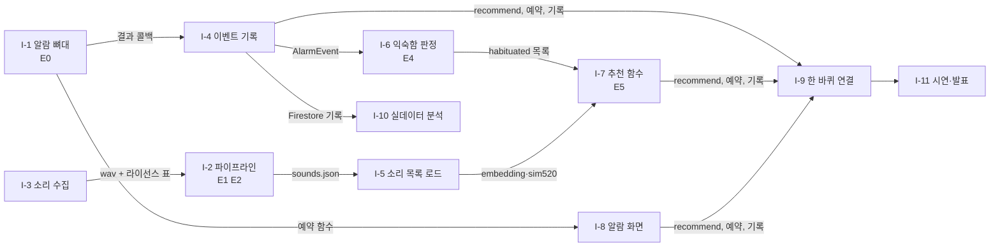

# 아빠 안잔다 — 이슈 초안

> 등록 현황(2026-11-14): I-1 → #1, I-2 → #2. 나머지는 팀 검토 뒤 등록한다(등록 직전에 열린 이슈를 다시 조회해 중복을 막는다). 이슈 본문에서 설계 내용은 [design.md](design.md) 절 링크로 가리킨다.

## 완성의 범위

v1 = [design.md 1.1](design.md#11-범위)의 "반드시" 전부 + 6절 실험 E0·E1·E2·E4·E5.
뺀 것: 사용자 음원 추가, 휴식 후 복귀, iOS, E3(라벨이 모자라면).

## 담당 제안 (회의에서 확정)

| 사람 | 영역 | 이슈 | 지금 시작 가능 |
|---|---|---|---|
| A | 앱: 알람·기록 | I-1, I-4, I-8, I-9 | I-1 |
| B | 앱: 추천 | I-5, I-6, I-7 | I-6, I-7 (계약 예시 데이터로) |
| C | AI: 소리·파이프라인 | I-2, I-3, I-10 | I-2, I-3 |
| 누구든 | 설정 | I-0 | I-0 |
| 전원 | 마무리 | I-11 | — |

## 의존성 그래프

화살표 = "먼저 있어야 함", 라벨 = 넘겨주는 것.

I-2·I-3은 동시에 시작한다: 파이프라인은 대조 소리 5개(합성 + 아무 무료 음원)로 먼저 만들고, 수집된 소리가 오면 다시 돌린다. I-6·I-7은 [4.4 데이터 계약](design.md#44-데이터-계약)의 예시로 먼저 만든다.

## 마일스톤

| 마일스톤 | 기한 | 이슈 |
|---|---|---|
| M1 뼈대 | 11/16 | I-0, I-1, I-2, I-3 |
| M2 추천 한 바퀴 | 11/19 | I-4, I-5, I-6, I-7, I-8, I-9 |
| M3 실험 반영 | 11/20 | I-10, (E4·E5 반영 PR) |
| M4 제출 | 11/21 | I-11 |

라벨: `area:app-alarm` `area:app-recommend` `area:ai` `experiment` `chore`

---

## I-0 레포 설정과 평가표 확인 `chore`

### 이 이슈는
README와 실제 설정이 다른 곳을 맞추고, 평가 기준 원문을 확인한다. 평가표 없이 범위를 잡으면 심사에서 보는 것을 놓친다.
- 먼저 필요: 없음(지금 시작 가능)
- 이게 끝나면: 범위 조정이 필요하면 design.md 1.1 수정

### 할 일
- [ ] GitHub 기본 브랜치를 `develop`으로 변경(지금은 `main`)
- [ ] 공모전 평가표 원문을 읽고 [design.md 0절](design.md#0-틀) 평가 기준 칸 채우기
- [ ] `app.json`의 `name`·`slug`·`scheme`을 템플릿 값 `app`에서 프로젝트 이름으로
- [ ] README의 "React Native Reusables 우선 사용"을 실제 설치 여부에 맞게 정리

### 완료 조건
- [ ] 새 PR을 열면 대상이 기본으로 `develop`

## I-1 (#1) 알람 뼈대: 지정한 소리로 울리고 결과 받기 `area:app-alarm` `experiment`

### 이 이슈는
설계 전체가 기대는 가정 R1을 확인한다(실험 E0). 틀리면 다른 이슈 전부의 일정이 바뀌므로 가장 먼저 한다. 기능은 최소: 버튼 하나로 "2분 뒤, 소리 X로 알람".
- 먼저 필요: 없음(지금 시작 가능)
- 이게 끝나면: I-4, I-8

### 할 일
- [ ] SDK 58 문서에서 예약 알림·알림 채널·알림 소리 제약 확인(`app/AGENTS.md` 규칙: 기억 말고 문서)
- [ ] 소리 2개를 번들하고, 예약할 때 소리를 고를 수 있게
- [ ] 끄기·스누즈 버튼 결과를 앱이 받는 경로, 무응답 판정 방법([design.md 2.4](design.md#24-시퀀스-알람-한-번)의 `?`)
- [ ] 앱이 꺼진 상태 포함 10회 측정 → [6절 E0](design.md#6-구현하면서-하는-실험) 결과 기록

### 완료 조건
- [ ] 실기기 측정 표(맞는 소리 비율, 지연)와 결론 한 단락: 기본안 유지 / 개발 빌드 전환
- [ ] 전환이면 팀에 즉시 공유하고 일정 표 수정

## I-2 (#2) 오프라인 파이프라인: sounds.json 만들기 `area:ai` `experiment`

### 이 이슈는
소리마다 YAMNet 임베딩과 520 유사도를 미리 계산해 앱에 넘긴다(AD1). 실험 E1·E2를 여기서 한다.
- 먼저 필요: 없음(대조 소리로 시작 가능). I-3이 끝나면 다시 실행
- 이게 끝나면: I-5

### 할 일
- [ ] YAMNet 불러오기(TF Hub 또는 공개 가중치)와 실제 출력 모양 확인: 조각 수 × 1024, × 521 ([2.3](design.md#23-데이터-흐름도))
- [ ] 520 Hz 사각파 3초 합성(16 kHz)
- [ ] `sim520` 세 방식 A·B·C 계산([4.3](design.md#43-520-유사도-후보-e2에서-하나-고름))
- [ ] `sounds.json` 출력([4.4 계약](design.md#44-데이터-계약)) + 모양 검사 assert
- [ ] E1: 계열별 코사인 히트맵·분포 / E2: 대조 소리 5개 순위 표
- [ ] `requirements.txt`에 YAMNet 실행 의존성 추가(현재 torch만 있음, YAMNet 공식 구현은 TensorFlow)

### 완료 조건
- [ ] 히트맵·순위 표 이미지가 PR에 있고, E1·E2 결론 한 단락씩

## I-3 소리 목록 수집 `area:ai`

### 이 이슈는
추천 후보가 될 알람 음원 30~50개를 라이선스와 함께 모은다(D6, R6). 후보가 적으면 추천이 의미 없다.
- 먼저 필요: 없음(지금 시작 가능)
- 이게 끝나면: I-2 재실행

### 할 일
- [ ] 출처·라이선스·계열(`group`) 표 작성. 계열은 벨·멜로디·경보·자연음·음성 등 4~6종, 계열마다 5개 이상(E1에 필요)
- [ ] 앱 번들용 mp3 변환(iOS 알림이면 30초 이하 — I-1 결과 따라)
- [ ] 원본은 `ai/data/`(git 제외), 공유는 팀 드라이브

### 완료 조건
- [ ] 라이선스 표에 빈 칸 없음

## I-4 이벤트 기록 `area:app-alarm`

### 이 이슈는
알람마다 결과를 기기에 저장하고 Firestore에 올린다(D3, AD6). 익숙함 판정과 실데이터 분석의 재료다.
- 먼저 필요: I-1(결과 콜백). 계약은 정해져 있으니 저장 부분은 먼저 시작 가능
- 이게 끝나면: I-6, I-9, I-10

### 할 일
- [ ] Firebase 익명 인증
- [ ] `AlarmEvent`([4.4](design.md#44-데이터-계약)) 저장: 기기 먼저, 온라인이면 `users/{uid}/events`
- [ ] 결과 분류 `dismissed`·`dismissed_late`·`snoozed`·`timeout`([4.1](design.md#41-신호--익숙해짐))
- [ ] Firestore 보안 규칙: 자기 `uid` 경로만 읽고 쓰기

### 완료 조건
- [ ] 알람 3회 뒤 Firestore 콘솔 화면에 이벤트 3개

## I-5 소리 목록 로드 `area:app-recommend`

### 이 이슈는
`sounds.json`과 소리 파일을 앱에 넣고 타입을 정한다.
- 먼저 필요: I-2(진짜 파일). 계약 예시로 먼저 시작 가능
- 이게 끝나면: I-7

### 할 일
- [ ] `Sound` 타입과 로더, 앱 시작 시 한 번 읽기
- [ ] 소리 파일 번들 방식은 I-1 결과에 맞춤

### 완료 조건
- [ ] 소리 목록 화면(제목·계열·sim520)이 뜬다

## I-6 익숙함 판정과 설정 파일 `area:app-recommend` `experiment`

### 이 이슈는
이벤트에서 소리별 나쁜 신호를 세고 임계값을 넘으면 익숙해짐으로 표시한다. 실험값은 설정 파일 한 곳에(AD5). E4.
- 먼저 필요: 없음(가짜 이벤트로 시작 가능). 실데이터 확인은 I-4 뒤
- 이게 끝나면: I-7

### 할 일
- [ ] `app/src/lib/recommend-config.ts`: `T_ok` 60, `T_max` 300, `W` 5, `K` 2, `w` 0.5, `recentExclude` 3
- [ ] 판정 함수(순수 함수) + 단위 테스트(경계: 정확히 K번)
- [ ] 소리별 통계를 Zustand 스토어로(기존 `alarm-store.ts` 옆)

### 완료 조건
- [ ] 테스트 통과 출력, E4는 M3에서 실데이터로

## I-7 추천 함수 `area:app-recommend` `experiment`

### 이 이슈는
[4.2 점수](design.md#42-점수)를 순수 함수 `recommend(sounds, history, config)`로. E5.
- 먼저 필요: 없음(손으로 만든 임베딩으로 시작 가능)
- 이게 끝나면: I-9

### 할 일
- [ ] `pHabit`(최대 코사인), 최근 제외, 가중합, argmax. 반환은 `{ soundId, score, pHabit, sim520 }`
- [ ] 단위 테스트: Q4(최근 3개 제외), 익숙해진 소리와 같은 임베딩은 `pHabit = 1`
- [ ] 50개 기준 계산 시간 측정(Q2)
- [ ] E5: `w` 0~1 민감도 표

### 완료 조건
- [ ] 테스트 출력 + 민감도 표

## I-8 알람 화면 `area:app-alarm`

### 이 이슈는
Expo 템플릿 화면을 실제 화면으로 바꾼다: 알람 목록·추가·켜고 끄기, 다음 소리와 그 이유.
- 먼저 필요: I-1(예약 함수)
- 이게 끝나면: I-9

### 할 일
- [ ] 템플릿 화면·컴포넌트 정리(`npm run reset-project` 또는 직접)
- [ ] 목록·추가(시각 선택)·삭제, 기존 `useAlarmStore` 사용
- [ ] 알람 카드에 "다음 소리: 탁상 벨 (낯섦 0.8 · 520 유사 0.6)"

### 완료 조건
- [ ] 실행 화면 캡처

## I-9 한 바퀴 연결 `area:app-alarm`

### 이 이슈는
결과 → 판정 → 추천 → 재예약을 이어 [사용자 흐름](design.md#21-사용자-흐름) 3~6이 끝까지 돈다(Q5).
- 먼저 필요: I-4, I-7, I-8
- 이게 끝나면: I-11

### 할 일
- [ ] 결과 수신 시 통계 갱신 → `recommend()` → 다음 예약 교체
- [ ] 추천 당시 점수를 `AlarmEvent.scoreAtPick`에 저장

### 완료 조건
- [ ] 같은 소리로 스누즈 K번 → 다음 알람 소리가 바뀌는 녹화

## I-10 실데이터 분석 `area:ai` `experiment`

### 이 이슈는
팀 실사용 이벤트를 내려받아 E4(임계값)를 판단하고, 라벨이 충분하면 E3을 한다.
- 먼저 필요: I-4
- 이게 끝나면: 설정값 변경 PR

### 할 일
- [ ] Firestore 내보내기 스크립트 → `ai/notebooks/`
- [ ] 소리별 나쁜 신호 추이, 판정이 하루 이상치로 뒤집힌 사례
- [ ] (라벨 양·음 각 5개 이상이면) E3

### 완료 조건
- [ ] 결과 한 단락과 바꾼 설정값. 결론은 "동작 확인"까지만, 효과 주장 금지([design.md 1.5](design.md#15-품질-목표))

## I-11 시연·발표

- 먼저 필요: I-9
- [ ] 시연 시나리오(스누즈 K번 → 소리 교체 → 이유 화면)와 녹화
- [ ] 품질 목표 대 실측 표(Q1~Q5), 한계(효과 미검증, 문헌 근거 강도, 익명 계정)
- [ ] 근거 논문 원문 확인([design.md 7절](design.md#7-근거-자료-요약))
